# Plan

How every finding in `findings.md` gets fixed, in dependency order. Every numbered finding in sections 1–10, 12, 13 and 15 (716 of them) is assigned to exactly one step; the full mapping is the index at the end. Section 11 (dead-code crawl) and section 14 (Hawk) are handled as whole inventories by steps 0.6 and 6.3.

## Decisions needed before or during the work

| # | Decision | Blocks |
| --- | --- | --- |
| D1 | Write the error, illegal-state and test policy into the repo (`AGENTS.md`/`CLAUDE.md`) so every agent follows it | 0.1, and through it everything |
| D2 | How parallel agents get isolated copies. Your standing rule is one checkout and no worktrees; parallel agents editing one checkout collide. Options: worktrees for these agents only, per-agent exports under `/tmp` with their own branch, or one agent at a time in the shared checkout | How many lanes run at once |
| D3 | Sigurd: obtain and record the desktop embedding licence, or replace the face | 1.1 |
| D4 | Where "Help & Feedback" and "Upgrade to Go" lead, or whether to remove them | 3.5 |
| D5 | Whether Home, Marketplace and Usage are meant to be reachable now, and whether the full inspector returns or its functions move into the overview | 3.5 |
| D6 | SQL rule: your global prompt says SQLx, the project decision was rusqlite. The plan keeps rusqlite and moves queries into `.sql` files unless you say otherwise | 6.1 |
| D7 | Durability policy: `synchronous=FULL` for the whole database, or only for acknowledged user data (drafts, messages) | 1.5 |
| D8 | Localisation: fix plurals only, or build a message catalogue for real translations | 3.11 |
| D9 | Sandboxing scope for engines and MCP servers on Linux and Windows | 7.1 |
| D10 | Telemetry and crash-report upload: local crash files only, or opt-in upload | 0.4, 7.4 |
| D11 | Contributor and user documentation (your rule is no READMEs unless asked) | 7.3 |

## How the work runs

- **Agents:** Claude Opus 5.5 at medium effort, one per step or per PR within a step. Each gets the step text, its finding IDs and the relevant `findings.md` passages, the repo policy from 0.1, and the rule that every fix lands with a test that fails for a user-visible reason.
- **Pull requests:** one logical change per PR. Large steps split by crate or by subsystem (phase 2 is one PR per crate). Each PR goes through the review skill and lands on green CI.
- **Builds:** at most one heavy build at a time, sharing one target directory, at idle IO priority, with `/proc/pressure/io` checked first, because builds stall the disks while you use the Editor. In practice that caps parallelism at about three agents.
- **Order:** a step starts only when the steps it depends on have merged. Within a phase, steps that touch different crates run in parallel lanes.
- **Coordination:** each agent publishes its work and claims its files through the Artisan coordination tools before editing, so lanes do not overlap.

## Dependency graph

```mermaid
flowchart TD
  S0_1["0.1 Write the engineering policy into the repo"]
  S0_2["0.2 One lint policy for the whole workspace"]
  S0_3["0.3 CI that gates what ships"]
  S0_4["0.4 Crash and trace infrastructure"]
  S0_5["0.5 Shared test support"]
  S0_6["0.6 Delete dead code, assets and dependencies first"]
  S1_1["1.1 Licensing: stop shipping uncleared assets"]
  S1_2["1.2 Installer: legacy migration that cannot destroy data"]
  S1_3["1.3 Installer: account, status and update safety"]
  S1_4["1.4 Release pipeline: authenticated bootstrap and atomic publication"]
  S1_5["1.5 Forge: durable data and atomic transitions"]
  S1_6["1.6 Editor: never lose what the user typed or chose"]
  S1_7["1.7 Security: credentials, permissions and policy bypasses"]
  S1_8["1.8 OAuth for MCP servers"]
  S1_9["1.9 Crashes reachable from bad input"]
  S1_10["1.10 Vulnerability process"]
  S2_1["2.1 Errors and illegal states: shared crates"]
  S2_2["2.2 Errors and illegal states: forge-store"]
  S2_3["2.3 Errors and illegal states: engines and tools"]
  S2_4["2.4 Errors and illegal states: forge-runs, forge-http, forge"]
  S2_5["2.5 Errors and illegal states: editor-core"]
  S2_6["2.6 Errors and illegal states: Editor feature crates"]
  S2_7["2.7 Errors and illegal states: editor-aqua"]
  S2_8["2.8 Errors and illegal states: ae, then ban anyhow"]
  S3_1["3.1 Forge run lifecycle, agents and approvals"]
  S3_2["3.2 Engine processes and decoders"]
  S3_3["3.3 Engine customisation and installs"]
  S3_4["3.4 Sync protocol: SSE, relay, config sync, read acks"]
  S3_5["3.5 Editor screens and flows that do nothing or the wrong thing"]
  S3_6["3.6 Host scoping and stale completions"]
  S3_7["3.7 Empty, loading, error and overflow states"]
  S3_8["3.8 Copy, terminology and brand"]
  S3_9["3.9 Text input and IME"]
  S3_10["3.10 Accessibility semantics and visual access"]
  S3_11["3.11 Internationalisation"]
  S3_12["3.12 Media and resource caches"]
  S4_1["4.1 Forge resource bounds and idle cost"]
  S4_2["4.2 Blocking work off async and UI threads"]
  S4_3["4.3 Algorithms on hot paths"]
  S4_4["4.4 Determinism and injected time"]
  S4_5["4.5 Performance budgets in CI"]
  S5_1["5.1 Delete test noise"]
  S5_2["5.2 Transcript replay through Forge"]
  S5_3["5.3 Editor scenario harness and semantic snapshots"]
  S5_4["5.4 Simulation, contracts and visual checks"]
  S6_1["6.1 Rule cleanup: SQL, comments, test placement"]
  S6_2["6.2 Duplication and module splits"]
  S6_3["6.3 Narrow visibility"]
  S7_1["7.1 Isolation and sandboxing"]
  S7_2["7.2 Dependencies with no upstream"]
  S7_3["7.3 Developer experience and project hygiene"]
  S7_4["7.4 Operations"]
  S0_1 --> S0_2
  S0_2 --> S0_3
  S0_2 --> S0_4
  S0_2 --> S0_5
  S0_2 --> S0_6
  S0_6 --> S1_1
  S0_4 --> S1_2
  S0_4 --> S1_3
  S0_3 --> S1_4
  S0_4 --> S1_5
  S0_5 --> S1_5
  S0_4 --> S1_6
  S0_5 --> S1_6
  S0_4 --> S1_7
  S1_7 --> S1_8
  S0_4 --> S1_9
  S0_3 --> S1_10
  S0_2 --> S2_1
  S0_4 --> S2_1
  S0_6 --> S2_1
  S2_1 --> S2_2
  S2_1 --> S2_3
  S2_2 --> S2_4
  S2_3 --> S2_4
  S2_1 --> S2_5
  S2_5 --> S2_6
  S2_6 --> S2_7
  S2_4 --> S2_8
  S2_7 --> S2_8
  S2_4 --> S3_1
  S2_3 --> S3_2
  S2_3 --> S3_3
  S2_4 --> S3_4
  S2_5 --> S3_4
  S0_5 --> S3_4
  S2_7 --> S3_5
  S2_6 --> S3_6
  S2_6 --> S3_7
  S2_7 --> S3_7
  S3_5 --> S3_8
  S2_6 --> S3_9
  S3_9 --> S3_10
  S3_10 --> S3_11
  S2_6 --> S3_12
  S2_4 --> S4_1
  S3_2 --> S4_1
  S4_1 --> S4_2
  S2_6 --> S4_3
  S2_2 --> S4_3
  S0_5 --> S4_4
  S4_3 --> S4_5
  S0_3 --> S4_5
  S0_5 --> S5_1
  S5_1 --> S5_2
  S3_4 --> S5_2
  S5_2 --> S5_3
  S5_3 --> S5_4
  S2_8 --> S6_1
  S2_8 --> S6_2
  S6_2 --> S6_3
  S2_3 --> S7_1
  S1_7 --> S7_1
  S0_3 --> S7_2
  S0_3 --> S7_3
  S0_4 --> S7_4
  S1_4 --> S7_4
```

## Phase 0: Foundations

### 0.1 Write the engineering policy into the repo

**Depends on:** nothing  
**Closes:** 0 findings

AGENTS.md/CLAUDE.md section with the error policy (typed recoverable enums, step/ids/cause, no anyhow), illegal states unrepresentable and invariant breaks crash with a trace, test rules, SQL rules, no comments. Every later step's agent reads it.

### 0.2 One lint policy for the whole workspace

**Depends on:** 0.1  
**Closes:** 5 findings (3 medium, 2 low)

Merge the nine copied clippy.toml files into one, make every crate `[lints] workspace = true`, move shared dependency blocks to `workspace = true`. Policy change: deny `unwrap_used`, allow `expect`/`unreachable!` only with an invariant message (replaces the blanket `clippy::panic` deny), add `map_err_ignore` and `let_underscore_must_use`. Pre-existing violations get a per-crate allow list that later steps shrink to zero.

Findings

| ID | Severity | Where | Finding |
| --- | --- | --- | --- |
| S12.2-1 | medium | `crates/editor-aqua/clippy.toml:1` | crates/editor-aqua/clippy.toml:1-78 is copied verbatim into editor-composer, editor-conversation, editor-inspector, editor-marketplace, editor-settings, editor-sidebar, editor-sources  |
| S12.2-2 | medium | `Cargo.toml` | The editor crates' Cargo.toml files share 34–40-line identical blocks: editor-composer/Cargo.toml:31-66 matches editor-conversation, editor-core, editor-inspector, editor-marketplace and  |
| S5.1-9 | medium | `Cargo.toml:36` | Editor crates bypass the workspace’s stronger lint policy. |
| S7.2-46 | low | `crates/editor-core/Cargo.toml:36` | Workspace lint strength is not uniform across the application. |
| S9.1-15 | low | `crates/ae/src/install.rs:10` | Explicit repository rules remain unenforced. |

### 0.3 CI that gates what ships

**Depends on:** 0.2  
**Closes:** 12 findings (1 high, 9 medium, 2 low)

nextest with timeouts and --no-fail-fast on every OS, the full workspace on macOS, a rustfmt gate, cargo-deny (advisories, licences, bans), the vendor validation package, tests/nix/dev.py where it can run, a default-features build without test-support, CI on stacked PRs, a target cache keyed to the source revision, branch protection on master. Qualification-gated tests are either run in a CI job or deleted in 6.1.

Findings

| ID | Severity | Where | Finding |
| --- | --- | --- | --- |
| S7.1-2 | high | `crates/editor-aqua/tests/qualification.rs:1` | Valuable integration and visual checks are outside the default gate. |
| S10.1-7 | medium | `.github/workflows/ci.yml:3` | Released-product PR discipline is bypassable and bypassed. |
| S6.1-11 | medium | `Cargo.toml:33` | Vendor regression checks do not participate in CI. |
| S7.1-5 | medium | `crates/forge-runs/src/tests.rs:709` | Polling regressions can consume the entire CI job. |
| S7.1-9 | medium | `ci.yml:58` | Static and non-Rust checks are incomplete. |
| S7.2-12 | medium | `.github/workflows/ci.yml:6` | Stacked PRs bypass CI. |
| S7.2-18 | medium | `crates/editor-aqua/Cargo.toml:74` | PR checks do not establish that the Editor builds without test support. |
| S8.1-13 | medium | `release.yml:208` | Release controls omit native signing and dependency vulnerability gates. |
| S9.1-11 | medium | `ci.yml:96` | Green CI excludes important supported behavior. |
| S9.1-12 | medium | `ci.yml:56` | Exact cache hits preserve stale workspace artifacts. |
| S7.2-47 | low | `.github/workflows/ci.yml:66` | Linux stops after the first failing test executable. |
| S7.2-48 | low | `.github/workflows/ci.yml:56` | Exact cache hits prevent the build cache from advancing with source changes. |

### 0.4 Crash and trace infrastructure

**Depends on:** 0.2  
**Closes:** 12 findings (4 medium, 8 low)

Release profile keeps line tables with split debuginfo and archives symbols per release; a panic hook in the Editor, Forge and ae writes a crash report (invariant message, ids, location, backtrace, span context, last log lines) before aborting; logging and trace initialisation failures surface instead of vanishing; Forge rotates its own log; tracing spans carry thread/run/host ids so errors can capture a SpanTrace. Prerequisite for every step that turns a silent bail-out into a crash.

Findings

| ID | Severity | Where | Finding |
| --- | --- | --- | --- |
| S9.1-10 | medium | `Cargo.toml:165` | Released crashes lack usable symbolication artifacts. |
| S9.1-8 | medium | `crates/forge/src/main.rs:190` | Forge file logs remain unbounded during operation. |
| S9.2-22 | medium | `crates/forge-http/src/upgrade/process.rs:55` | Detached Unix Forge loses backend and replacement-gateway logs. |
| S9.2-39 | medium | `crates/editor-aqua/src/launch.rs:56` | Setup and top-level launch failures bypass persistent diagnostics. |
| S4.2-61 | low | `crates/forge-engines/src/trace.rs:56` | Diagnostic trace failures omit their cause. |
| S5.2-36 | low | `crates/editor-aqua/src/logging.rs:12` | Failure to initialize file logging is silently discarded. |
| S6.2-70 | low | `crates/forge-isolation/src/linux.rs:225` | Failed Linux isolation attachment is invisible. |
| S9.1-14 | low | `crates/forge-engines/src/trace.rs:56` | Trace initialization discards the actual failure cause. |
| S9.2-53 | low | `crates/editor-aqua/src/logging.rs:12` | Editor logging initialization silently discards failures. |
| S9.2-54 | low | `crates/editor-core/src/core/diagnostics/open_timing.rs:27` | Open-timing diagnostics bypass the file logger. |
| S9.2-69 | low | `crates/forge-engines/src/trace.rs:84` | Trace truncation and dropped records are indistinguishable from complete traces. |
| S9.2-72 | low | `crates/forge-runs/src/runtime/registry.rs:58` | Registry failures lose the file and generation needed to diagnose them. |

### 0.5 Shared test support

**Depends on:** 0.2  
**Closes:** 8 findings (3 medium, 5 low)

A tests/support crate: builders for Item/HostConfig/UiApp, one scene walker, bounded waits instead of sleeps and unbounded polls, a paused-tokio-clock helper, fixed fake HTTP/SSE servers. Moves `Core::for_tests`, the `test_*` hooks and `*Fixture` structs out of `src/` as each crate is touched. Every later regression test uses it.

Findings

| ID | Severity | Where | Finding |
| --- | --- | --- | --- |
| S7.2-15 | medium | `crates/forge-http/src/tests.rs:60` | The SSE test reader corrupts split UTF-8. |
| S7.2-16 | medium | `crates/forge-http/src/tests.rs:59` | Premature SSE closure can pass the resume test. |
| S7.2-21 | medium | `crates/forge-runs/src/tests.rs:3573` | Negative asynchronous assertions use elapsed time as completion evidence. |
| S12.2-18 | low | `crates/editor-aqua/tests/conversation/presentation.rs` | Test setup is copied rather than shared. The most duplicated file is crates/editor-aqua/tests/conversation/presentation.rs (760 lines in clones). Others: tests/shell/root.rs (285-329 with 422-466, |
| S7.2-28 | low | `crates/editor-aqua/tests/core/ordering.rs:397` | The blocked-sender test signals readiness before reaching the blocking operation. |
| S7.2-29 | low | `crates/editor-aqua/tests/shell/lifetime.rs:13` | A test listener thread never shuts down. |
| S7.2-30 | low | `crates/ae/tests/detached_service.rs:105` | Service tests release their port reservation before starting the service. |
| S7.2-33 | low | `crates/artisan-account/tests/network.rs:17` | Fake HTTP server shutdown depends on an exact request count. |

### 0.6 Delete dead code, assets and dependencies first

**Depends on:** 0.2  
**Closes:** 21 findings (15 low, 6 nit)

Everything in findings.md section 11 (unused fonts, 34 SVGs, two fixtures, 97 uncalled declarations, the legacy-import feature and its importers once confirmed retired, scripts/release) and section 13 (unused dependencies, empty test targets), plus the 250 `hawk::dead_public` items in section 14.1 after per-item review. Done before the migrations so nothing dead gets migrated.

Findings

| ID | Severity | Where | Finding |
| --- | --- | --- | --- |
| S1.2-55 | low | `crates/editor-aqua/tests/frame/sidebar.rs:6` | Sidebar tests cover presentation state that the shell no longer consumes. |
| S13.1-1 | low | `crates/claude-ai-browser/Cargo.toml:16` | crates/claude-ai-browser/Cargo.toml:16 tracing is never used (both tools). |
| S13.1-2 | low | `crates/claude-ai-browser/Cargo.toml:19` | crates/claude-ai-browser/Cargo.toml:19 dev-dependency tempfile is never used (shear). |
| S13.1-3 | low | `crates/editor-aqua/Cargo.toml:70` | crates/editor-aqua/Cargo.toml:70 color is never used (shear). |
| S13.1-4 | low | `crates/editor-conversation/Cargo.toml:27` | crates/editor-conversation/Cargo.toml:27 image, with seven codec features, is never used (both tools). Each codec adds compile time. |
| S13.1-5 | low |  | crates/editor-conversation dev-dependency tempfile is never used (machete). |
| S13.1-6 | low | `crates/editor-sidebar/Cargo.toml:21` | crates/editor-sidebar/Cargo.toml:21 image is never used (both tools). |
| S13.1-7 | low | `crates/forge-computer/Cargo.toml:15` | crates/forge-computer/Cargo.toml:15 serde is never used (both tools). |
| S13.1-8 | low | `crates/editor-inspector/Cargo.toml:25` | crates/editor-inspector/Cargo.toml:25 depends on editor-sidebar only for a feature, and no code uses it (both tools; slice 5 found the same). |
| S13.2-10 | low | `Cargo.toml:79` | Cargo.toml:79 tokio-stream is declared in [workspace.dependencies] but no crate uses it. |
| S13.2-11 | low | `Cargo.toml:97` | Cargo.toml:97 native-dialog, same. |
| S13.2-12 | low | `Cargo.toml:118` | Cargo.toml:118 symphonia, same. |
| S13.2-13 | low | `Cargo.toml:145` | Cargo.toml:145 unicode-segmentation, same. |
| S13.2-14 | low | `Cargo.toml:147` | Cargo.toml:147 zip, same. |
| S6.1-14 | low | `Cargo.toml:96` | The workspace dependency catalogue contains stale declarations. |
| S10.2-36 | nit | `Cargo.toml:96` | Mermaid has two conflicting dependency declarations. |
| S13.1-9 | nit | `vendor/highlighting/validation/Cargo.toml` | vendor/highlighting/validation/Cargo.toml declares once_cell, onig, serde and serde_json without using them (machete). This package sits outside the workspace and CI. |
| S13.3-15 | nit |  | 27 library targets keep doctest = true with no doc tests, so cargo test compiles and runs an empty doctest binary for each. Set doctest = false once for the workspace. |
| S13.3-16 | nit |  | 6 targets keep test = true with no tests (test_enabled_without_tests): |
| S3.2-60 | nit | `crates/editor-conversation/src/conversation/scroll.rs:134` | row_destination has no repository caller. |
| S6.2-73 | nit | `crates/forge-mcp/src/tools.rs:926` | Superseded thread-list dispatch code remains reachable only through an internal bypass. |

## Phase 1: Stop the damage: data loss, security, licensing, crashes

### 1.1 Licensing: stop shipping uncleared assets

**Depends on:** 0.6  
**Closes:** 15 findings (3 high, 4 medium, 3 low, 5 nit)

Founders Grotesk, Artisan Neo and Cal Sans removed with their notices (0.6 handles the files); Sigurd replaced or its licence recorded (needs your decision); generated third-party notices for Editor, Forge and ae from the locked dependency graph, shipped and reachable in-app; notes reconciled with BSD-3-Clause.

Findings

| ID | Severity | Where | Finding |
| --- | --- | --- | --- |
| S10.1-1 | high | `crates/editor-assets/src/fonts.rs:96` | Evaluation-only fonts enter release binaries. |
| S10.1-2 | high | `crates/editor-assets/src/fonts.rs:55` | Sigurd ships despite an explicit unresolved release prerequisite. |
| S10.1-3 | high | `crates/editor-aqua/build.rs:39` | Shipped notices omit runtime dependency attribution. |
| S10.1-10 | medium | `crates/editor-assets/licenses/artisan-first-party-NOTES.md:38` | Distributed artwork notes contradict the actual licence. |
| S10.2-12 | medium | `nix/workspace.nix:25` | Nix source filtering excludes a required licence file. |
| S10.2-14 | medium | `crates/editor-assets/licenses/svgl-brand-marks-NOTES.md:31` | Brand-asset notes promise review flags that no longer exist. |
| S10.2-17 | medium | `crates/editor-assets/fonts/FONTS.md:30` | , suspected — Artisan Neo source redistribution lacks a resolved attribution record. |
| S10.2-20 | low | `crates/editor-settings/src/settings/view.rs:401` | Installed third-party notices have no in-app discovery route. |
| S10.2-25 | low | `crates/editor-assets/fonts/FONTS.md:40` | Font-maintenance instructions describe obsolete rendering APIs. |
| S5.1-11 | low | `crates/editor-assets/src/fonts.rs:1` | Widespread comments directly violate the code rule. |
| S10.2-29 | nit | `crates/editor-assets/licenses/svgl-brand-marks-NOTES.md:3` | Asset provenance scopes reference removed directories and stale inventories. |
| S10.2-30 | nit | `crates/editor-assets/fonts/FONTS.md:69` | The font document repeats its evaluation section. |
| S10.2-33 | nit | `README.md:30` | The public licence name differs from the repository’s precise identifier. |
| S10.2-35 | nit | `crates/editor-assets/src/fonts.rs:15` | First-party code still contains prohibited explanatory comments. |
| S2.2-57 | nit | `crates/editor-assets/src/fonts.rs:1` | The font catalog violates the no-comments rule throughout. |

### 1.2 Installer: legacy migration that cannot destroy data

**Depends on:** 0.4  
**Closes:** 10 findings (5 high, 3 medium, 2 low)

Delete only what was migrated, copy into a staging directory and rename on success, scope program removal to the chosen component, verify process identity before killing a PID, resume failed Codex rollout retargeting, preserve symlinks across volumes.

Findings

| ID | Severity | Where | Finding |
| --- | --- | --- | --- |
| S6.1-1 | high | `crates/ae/src/legacy.rs:64` | Installer migration deletes data it never migrated. |
| S9.2-16 | high | `crates/ae/src/legacy.rs:65` | Legacy cleanup can delete Editor data it never migrated. |
| S9.2-17 | high | `crates/ae/src/legacy.rs:239` | Interrupted legacy copies are mistaken for completed migrations. |
| S9.2-18 | high | `crates/ae/src/legacy.rs:70` | Component migration removes programs outside the selected component. |
| S9.2-19 | high | `crates/ae/src/legacy.rs:203` | Legacy PID files can kill unrelated processes. |
| S9.2-40 | medium | `crates/ae/src/legacy.rs:49` | Failed Codex rollout retargeting is never resumed. |
| S9.2-41 | medium | `crates/ae/src/legacy.rs:262` | Symlink repair can destroy a link and still report successful migration. |
| S9.2-42 | medium | `crates/ae/src/legacy.rs:237` | Legacy migration silently merges into non-empty destinations. |
| S9.2-45 | low | `crates/ae/src/legacy.rs:317` | Cross-volume migration does not preserve symlinks. |
| S9.2-73 | low | `crates/ae/src/legacy.rs:294` | Migration queries do not follow the required typed-query approach. |

### 1.3 Installer: account, status and update safety

**Depends on:** 0.4  
**Closes:** 48 findings (6 high, 20 medium, 19 low, 3 nit)

Atomic private-file writes for the account key; read-only diagnostic connections and exclusive locks for anything that migrates; per-component update eligibility and resumable installs; a controlled stop-migrate-start path for schema changes; deadlines and size limits on every download; per-run staging directories; Windows replacement with rollback; service start deadlines; uninstall that only removes what it owns.

Findings

| ID | Severity | Where | Finding |
| --- | --- | --- | --- |
| S4.2-20 | high | `crates/forge-store/src/admin.rs:31` | Offline administration can migrate a running older Forge’s database. |
| S6.2-15 | high | `crates/ae/src/account.rs:456` | Offline account sync constructs asynchronous services outside a runtime. |
| S6.2-18 | high | `crates/ae/src/account.rs:96` | Account persistence can destroy the only machine private key. |
| S9.1-1 | high | `crates/ae/src/install.rs:713` | Partial updates falsely become “up to date.” |
| S9.1-2 | high | `crates/ae/src/install.rs:536` | Running Unix Forge cannot accept schema-changing updates. |
| S9.1-3 | high | `crates/ae/src/status.rs:69` | A diagnostic command can migrate a live database. |
| S6.2-31 | medium | `crates/ae/src/release.rs:154` | Release downloads can wait indefinitely. |
| S6.2-32 | medium | `crates/ae/src/install.rs:515` | Concurrent installers mutate the same staging directory. |
| S6.2-33 | medium | `crates/ae/src/install.rs:618` | Windows executable replacement has no rollback. |
| S6.2-34 | medium | `crates/ae/src/install.rs:93` | Unsupported installer destinations silently become “do not install.” |
| S6.2-48 | medium | `crates/forge-store/src/admin.rs:31` | Administrative commands can migrate a database underneath an older running Forge. |
| S8.2-33 | medium | `crates/ae/src/release.rs:154` | Release fetching has neither a size limit nor an overall deadline. |
| S9.1-9 | medium | `crates/ae/src/release.rs:154` | Release downloads can hang indefinitely. |
| S9.2-20 | medium | `crates/ae/src/install.rs:368` | Concurrent installers delete each other’s staging files. |
| S9.2-21 | medium | `crates/ae/src/service.rs:120` | Windows autostart bypasses lifecycle bookkeeping. |
| S9.2-23 | medium | `crates/ae/src/install.rs:747` | The advertised follow-up purge cannot remove retained data. |
| S9.2-24 | medium | `crates/ae/src/platform.rs:216` | Removing ae alone breaks the remaining Windows uninstallers. |
| S9.2-25 | medium | `crates/ae/src/install.rs:99` | “Keep” silently omits WSL Forge when native Forge exists. |
| S9.2-26 | medium | `crates/ae/src/wsl.rs:56` | WSL discovery ignores supported custom install locations. |
| S9.2-27 | medium | `crates/ae/src/install.rs:244` | Declining installation still changes the persistent install location. |
| S9.2-28 | medium | `crates/ae/src/install.rs:561` | Local builds retain an earlier release feed. |
| S9.2-34 | medium | `crates/ae/src/release.rs:192` | Unauthenticated release responses can exhaust installer memory. |
| S9.2-36 | medium | `crates/ae/src/service.rs:214` | Forge can be reported ready before its backend starts. |
| S9.2-37 | medium | `crates/ae/src/service.rs:209` | Service startup has no deadline or cancellation path. |
| S9.2-38 | medium | `crates/ae/src/service.rs:260` | Windows updates immediately force-kill running engine trees. |
| S9.2-44 | medium | `crates/ae/src/wsl.rs:49` | WSL discovery and diagnostics can block indefinitely. |
| S10.2-18 | low | `crates/forge/build.rs:5` | Incremental development builds can report an old commit. |
| S10.2-26 | low | `crates/ae/src/account.rs:495` | The account persistence test bypasses the persistence implementation. |
| S12.2-5 | low | `crates/ae/build.rs:6` | crates/ae/build.rs:6-27 duplicates crates/forge/build.rs:5-26. Share the build script logic. |
| S6.2-60 | low | `crates/ae/src/account.rs:60` | Account state is a collection of independent optional fields. |
| S6.2-66 | low | `crates/ae/src/account.rs:495` | Account persistence tests bypass account persistence. |
| S8.2-42 | low | `crates/ae/src/forge.rs:70` | Pairing completion is inferred from an unrelated device-count change. |
| S9.2-50 | low | `crates/ae/src/service.rs:24` | Service address errors become plausible but incorrect defaults. |
| S9.2-51 | low | `crates/ae/src/status.rs:69` | Database failures are reported as zero paired devices. |
| S9.2-52 | low | `crates/ae/src/status.rs:14` | Failed WSL diagnostics disappear from status output. |
| S9.2-57 | low | `crates/ae/src/service.rs:86` | User services retain the installer’s transient PATH. |
| S9.2-58 | low | `crates/ae/src/service.rs:133` | Offline uninstall leaves systemd autostart configuration behind. |
| S9.2-59 | low | `crates/ae/src/platform.rs:166` | Uninstall deletes protocol registration without checking ownership. |
| S9.2-60 | low | `crates/ae/src/install.rs:358` | Installer staging leaks when launching a child fails. |
| S9.2-62 | low | `crates/ae/build.rs:6` | ae and Forge can report stale Git revisions in development builds. |
| S9.2-64 | low | `crates/ae/src/release.rs:332` | Unreadable local version files become fabricated versions. |
| S9.2-65 | low | `crates/ae/src/install.rs:407` | Remembered release feeds are not validated at the boundary. |
| S9.2-66 | low | `crates/ae/src/install.rs:93` | Unsupported placement combinations are silently accepted. |
| S9.2-68 | low | `crates/ae/src/install.rs:842` | Windows self-uninstall never completes directory and location cleanup. |
| S9.2-71 | low | `crates/ae/src/sys.rs:110` | File removal treats metadata failures as successful absence. |
| S7.2-54 | nit | `crates/ae/tests/account_json.rs:1` | Test files retain prohibited explanatory comments. |
| S9.2-74 | nit | `crates/ae/src/platform.rs:25` | Windows PATH normalization is inconsistent. |
| S9.2-75 | nit | `crates/ae/src/platform.rs:280` | Process-close deadlines are duplicated across implementations. |

### 1.4 Release pipeline: authenticated bootstrap and atomic publication

**Depends on:** 0.3  
**Closes:** 13 findings (4 high, 6 medium, 3 low)

install.sh/irm verify release.json.sig against a pinned key before executing anything; publish immutable assets and switch one channel pointer last; the latest feed never moves backwards; a schema backup before migrating so rollback works; Nix release outputs fixed or retired; tests for tampered manifests and signatures.

Findings

| ID | Severity | Where | Finding |
| --- | --- | --- | --- |
| S8.1-1 | high | `scripts/install.sh:36` | Bootstrap executes an installer without authenticating its signature. |
| S9.1-4 | high | `release.yml:304` | Nightly publication exposes mixed generations. |
| S9.1-5 | high | `scripts/install.sh:36` | Bootstrap execution bypasses manifest authentication. |
| S9.1-6 | high | `nix/workspace.nix:25` | Advertised Nix build/release paths contain deterministic missing inputs. |
| S10.1-9 | medium | `nix/release.nix:91` | An exposed release-maintenance route references a deleted installer. |
| S12.2-3 | medium | `.github/workflows/release.yml:85` | .github/workflows/release.yml:85-121 duplicates release.yml:153-189. Fixes to one build job miss the other. Use a matrix or a composite action. |
| S8.2-19 | medium | `crates/forge-engines/src/install.rs:639` | Engine downloads have no independent publisher-signature verification. |
| S9.1-7 | medium | `crates/forge-store/src/schema.rs:547` | Binary rollback does not recover migrated data. |
| S9.2-35 | medium | `nix/release.nix:44` | Nix release artifacts use an incompatible distribution format. |
| S9.2-43 | medium | `.github/workflows/release.yml:321` | Publishing an older stable version moves the latest feed backwards. |
| S8.2-48 | low | `crates/ae/src/release.rs:70` | Version-pinned installation does not verify the manifest’s version matches the pin. |
| S9.2-67 | low | `crates/ae/src/release.rs:70` | The version rollback option cannot resolve published nightlies. |
| S9.2-70 | low | `tests/release.py:55` | Release verification tests do not exercise invalid signatures or signed-manifest tampering. |

### 1.5 Forge: durable data and atomic transitions

**Depends on:** 0.4, 0.5  
**Closes:** 17 findings (9 high, 3 medium, 5 low)

Retention never deletes drafts; continuations are consumed in the same transaction that creates the run; blob GC and reference admission share one lock; acknowledged writes are durable (synchronous=FULL for acknowledged user data or an explicit checkpoint); events are emitted in sequence order; stop keeps delivery acknowledgements; storage failure settles the run; agent creation and agent completion are single transactions; orphaned rows are removed with their owners.

Findings

| ID | Severity | Where | Finding |
| --- | --- | --- | --- |
| S15.4-1 | high | `crates/forge-store/src/items.rs:234` | Stop can erase delivery acknowledgements and cause duplicate input delivery. |
| S15.4-2 | high | `crates/forge-runs/src/agents.rs:542` | Failed, unaccepted agent inputs are classified as working indefinitely. |
| S4.1-3 | high | `crates/forge-store/src/blobs.rs:239` | Blob collection can delete newly referenced images. |
| S4.1-4 | high | `crates/forge-runs/src/run.rs:45` | A crash can consume a continuation permanently. |
| S4.1-5 | high | `crates/forge-runs/src/run.rs:1285` | Storage errors can leave permanently running records on Windows. |
| S4.1-8 | high | `crates/forge-store/src/lib.rs:249` | Acknowledged database commits are not power-loss durable. |
| S4.2-16 | high | `crates/forge-runs/src/agents.rs:292` | Agent creation can leave a permanently working agent without any input. |
| S4.2-17 | high | `crates/forge-store/src/retention/threads.sql:5` | Retention deletes saved drafts on inactive threads. |
| S6.2-16 | high | `crates/forge-store/src/writer.rs:552` | Disabling retries publishes durable events out of sequence. |
| S4.2-22 | medium | `crates/forge-runs/src/agents.rs:800` | Background-agent completion and result delivery are separate durable decisions. |
| S6.2-47 | medium | `crates/forge-store/src/writer.rs:140` | Threads can be created under removed projects. |
| S8.2-30 | medium | `crates/forge-store/src/settings.rs:93` | Removing an MCP server leaves its OAuth secrets behind. |
| S4.2-60 | low | `crates/forge-store/src/lib.rs:554` | Checkpoint failure is recorded as completed work. |
| S6.2-54 | low | `crates/forge-store/src/writer.rs:158` | Thread ancestry is accepted without relational validation. |
| S6.2-57 | low | `crates/forge-store/src/writer.rs:485` | Updating a run can make its indexed thread disagree with its serialized thread. |
| S6.2-58 | low | `crates/forge-store/src/retention/remove.sql:1` | Thread retention leaves coordination data permanently orphaned. |
| S8.2-43 | low | `crates/forge-store/src/pairing.rs:147` | Expired pairing invitations are never collected. |

### 1.6 Editor: never lose what the user typed or chose

**Depends on:** 0.4, 0.5  
**Closes:** 29 findings (6 high, 19 medium, 4 low)

Unreadable settings are preserved and block saves until recovered; settings writes are serialised per key and roll back only their own mutation; drafts persist locally when Forge is unreachable and survive shutdown; the first draft load detects conflicts; failed-send recovery never truncates; page responses never overwrite newer SSE state; host and identity files are written atomically and durably with one owner; failed writes are reported as failures.

Findings

| ID | Severity | Where | Finding |
| --- | --- | --- | --- |
| S15.2-1 | high | `crates/editor-conversation/src/conversation/thread.rs:230` | correctness — Page responses overwrite newer SSE updates. |
| S15.2-2 | high | `crates/editor-composer/src/composer/controller.rs:763` | correctness — Failed-send recovery truncates and saves the next prompt. |
| S4.1-1 | high | `crates/editor-aqua/src/launch.rs:173` | Closing offline loses unsaved drafts. |
| S4.1-2 | high | `crates/editor-composer/src/composer/draft_session.rs:239` | Initial draft loading can silently overwrite an existing draft. |
| S5.1-1 | high | `crates/editor-settings/src/settings/controller.rs:564` | Stale settings failures overwrite newer state. |
| S5.1-2 | high | `crates/editor-core/src/core/store.rs:146` | Unreadable settings can be permanently overwritten. |
| S1.2-16 | medium | `crates/editor-settings/src/settings/controller.rs:128` | Changing hosts discards unsaved global instructions. |
| S1.2-17 | medium | `crates/editor-settings/src/settings/preferences.rs:19` | An older settings failure can overwrite a newer choice. |
| S1.2-19 | medium | `crates/editor-settings/src/settings/mcp_view.rs:171` | MCP edits made during saving are discarded. |
| S1.2-20 | medium | `crates/editor-settings/src/settings/mcp_view.rs:193` | MCP “Cancel” leaves the mutation running. |
| S15.2-10 | medium | `crates/editor-composer/src/composer/draft_session.rs:288` | data-structure — Failed draft writes accumulate duplicate complete JSON bodies. |
| S4.1-14 | medium | `crates/editor-core/src/core/hosts.rs:127` | Atomic configuration replacement is not durable replacement. |
| S4.2-31 | medium | `crates/editor-core/src/core/store.rs:131` | Unreadable configuration can subsequently be replaced with defaults. |
| S4.2-32 | medium | `crates/editor-core/src/core/hosts.rs:78` | Concurrent identity creation can persist a different identity from the one returned. |
| S4.2-33 | medium | `crates/editor-core/src/core/hosts.rs:91` | Atomic configuration replacement does not prevent lost updates between owners. |
| S4.2-34 | medium | `crates/editor-composer/src/composer/controller.rs:638` | Navigating away can lose an unfinished image attachment even while online. |
| S4.2-45 | medium | `crates/editor-core/src/core/store.rs:642` | Failed pairing persistence leaves an invisible connection that cannot be retried. |
| S5.2-16 | medium | `crates/editor-core/src/core/store.rs:642` | Failed pairing persistence creates an inaccessible connected host. |
| S5.2-17 | medium | `crates/editor-core/src/core/store.rs:462` | Setting writes can report success after rollback. |
| S5.2-22 | medium | `crates/editor-core/src/core/hosts.rs:127` | Configuration replacement lacks durability synchronization. |
| S9.1-13 | medium | `crates/editor-core/src/core/store.rs:467` | Settings calls acknowledge changes that failed. |
| S9.2-30 | medium | `crates/editor-core/src/core/store.rs:146` | Unreadable settings are overwritten by the next successful preference change. |
| S9.2-31 | medium | `crates/editor-core/src/core/hosts.rs:99` | Multiple Editor instances overwrite each other’s configuration changes. |
| S9.2-32 | medium | `crates/editor-core/src/core/hosts.rs:78` | Concurrent first launches can persist a different identity from the one in use. |
| S9.2-33 | medium | `crates/editor-settings/src/settings/preferences.rs:19` | Older setting failures can roll back newer successful changes. |
| S4.2-50 | low | `crates/editor-core/src/core/host/preferences.rs:99` | Failed picker preferences are discarded. |
| S4.2-51 | low | `crates/editor-core/src/core/agent_calls.rs:57` | Editor setting calls can acknowledge a write that failed. |
| S9.2-56 | low | `crates/editor-core/src/core/hosts.rs:127` | Atomic configuration replacement is not durable persistence. |
| S9.2-63 | low | `crates/editor-core/src/core/hosts.rs:63` | Configuration-path failures silently switch Editor to shared temporary storage. |

### 1.7 Security: credentials, permissions and policy bypasses

**Depends on:** 0.4  
**Closes:** 34 findings (9 high, 19 medium, 6 low)

Private permissions on the database, journal and MCP launch files; no secrets in process arguments; resource snapshots obey the same access policy as tools; Windows commands checked with cmd grammar; permission files fail closed; special files rejected before reading; config sync drops credentials when an endpoint changes; Claude browser-session transfer only to the host it was issued for; TLS handshake deadlines and admission limits; revocation closes live streams; remote images need consent; payloads redacted from logs; gateway credentials revoked with their thread; secret types get redacting Debug.

Findings

| ID | Severity | Where | Finding |
| --- | --- | --- | --- |
| S4.2-19 | high | `crates/forge-http/src/events.rs:343` | Offline revocation does not close a passive event subscriber. |
| S8.1-2 | high | `crates/forge-runs/src/resources.rs:251` | Agent output bypasses file-access policy through resource snapshots. |
| S8.1-3 | high | `crates/forge-store/src/lib.rs:185` | Forge’s credential database inherits permissive filesystem defaults. |
| S8.1-4 | high | `crates/forge-engines/src/customise.rs:136` | MCP launch files expose credentials through default permissions. |
| S8.2-14 | high | `crates/forge-engines/src/claudeai/rules.rs:837` | Windows command checks use the wrong shell grammar. |
| S8.2-15 | high | `crates/forge-engines/src/customise.rs:427` | Claude’s gateway credential is exposed in process arguments. |
| S8.2-16 | high | `crates/forge-http/src/sync.rs:397` | Config sync forwards existing credentials to replacement MCP destinations. |
| S8.2-17 | high | `crates/editor-core/src/core/host.rs:483` | Any connected Forge can trigger transfer of the local Claude browser session. |
| S8.2-18 | high | `crates/forge-engines/src/claudeai/tools.rs:725` | Read and Grep can consume unbounded special files. |
| S4.1-13 | medium | `crates/forge-runs/src/resources.rs:236` | WSL links can open the wrong distribution’s file. |
| S4.2-30 | medium | `crates/forge-http/src/lib.rs:416` | TLS handshakes have neither a deadline nor admission bound. |
| S4.2-41 | medium | `crates/forge-runs/src/resources.rs:285` | Resource validation can race into a blocking special-file open. |
| S4.2-42 | medium | `crates/forge-runs/src/resources.rs:345` | Historical resource snapshots can capture a later file version. |
| S6.2-20 | medium | `crates/forge-http/src/sync.rs:396` | Account sync overwrites locally created MCP servers with matching names. |
| S6.2-35 | medium | `crates/claude-ai-browser/src/lib.rs:281` | Browser captures have no exclusive owner. |
| S6.2-36 | medium | `crates/claude-ai-browser/src/lib.rs:84` | Cancelling browser capture bypasses browser cleanup. |
| S6.2-44 | medium | `crates/forge-engines/src/process.rs:148` | Ordinary diagnostic logging includes raw engine payloads. |
| S8.1-10 | medium | `crates/forge-engines/src/process.rs:148` | Engine payloads enter logs and diagnostic traces. |
| S8.1-11 | medium | `crates/editor-ui/src/ui/media/source.rs:338` | Rendering remote images silently contacts arbitrary destinations. |
| S8.1-9 | medium | `crates/forge-http/src/lib.rs:390` | Unauthenticated connections have no TLS deadline or admission bound. |
| S8.2-20 | medium | `crates/forge-engines/src/claudeai/rules.rs:160` | Unreadable or malformed permission files fail open. |
| S8.2-21 | medium | `crates/forge-engines/src/claudeai/mod.rs:627` | Task calls bypass permission-rule evaluation. |
| S8.2-23 | medium | `crates/forge-http/src/events.rs:342` | CLI revocation does not promptly close an existing SSE stream. |
| S8.2-24 | medium | `crates/forge-http/src/relay.rs:550` | Tunneled event streams do not independently enforce grant expiry. |
| S8.2-29 | medium | `crates/forge-runs/src/gateway.rs:43` | Deleted threads retain valid gateway credentials. |
| S8.2-31 | medium | `crates/forge-mcp/src/tools.rs:1567` | MCP listing sends credential-bearing URLs and arguments to the model. |
| S8.2-32 | medium | `crates/editor-core/src/core/host.rs:502` | Background Claude renewal can undo sign-out. |
| S8.2-34 | medium | `crates/claude-ai-browser/src/lib.rs:58` | Uninstall with purge leaves the authenticated browser profile behind. |
| S6.2-56 | low | `crates/artisan-account/src/enrollment.rs:13` | Credential-bearing types derive unrestricted Debug. |
| S6.2-59 | low | `crates/forge-runs/src/retention.rs:56` | Removed threads retain valid gateway credentials and memory entries. |
| S8.2-38 | low | `crates/artisan-api/src/tls.rs:17` | Secret-bearing public types derive unrestricted Debug. |
| S8.2-39 | low | `crates/claude-ai-browser/src/lib.rs:84` | Cancelling browser capture skips browser cleanup. |
| S8.2-40 | low | `crates/forge-http/src/routes.rs:973` | Private blobs are explicitly marked publicly cacheable. |
| S8.2-46 | low | `crates/artisan-account/src/network.rs:49` | , suspected — Session-token erasure may be optimized away. |

### 1.8 OAuth for MCP servers

**Depends on:** 1.7  
**Closes:** 23 findings (1 high, 16 medium, 5 low, 1 nit)

Registrations bound to issuer and resource URL; HTTPS-only endpoints with issuer validation; streaming size limits; sign-out cancels pending flows and in-flight refreshes; one refresh per rotating token; outages never delete valid credentials; unavailable servers are not 'no auth needed'; callback tests.

Findings

| ID | Severity | Where | Finding |
| --- | --- | --- | --- |
| S8.1-5 | high | `crates/forge-runs/src/mcp_auth.rs:142` | OAuth client credentials survive a change of provider. |
| S5.2-15 | medium | `crates/editor-core/src/core/mcp_sign_in.rs:230` | MCP sign-ins outlive their host’s authority. |
| S6.2-21 | medium | `crates/forge-runs/src/mcp_auth.rs:341` | Concurrent launches can refresh the same rotating OAuth token twice. |
| S6.2-22 | medium | `crates/forge-runs/src/mcp_auth.rs:224` | In-flight OAuth work can undo sign-out. |
| S6.2-23 | medium | `crates/forge-engines/src/mcp_oauth.rs:455` | Temporary OAuth server failures permanently discard credentials. |
| S6.2-24 | medium | `crates/forge-engines/src/mcp_oauth.rs:134` | An unavailable MCP server is classified as requiring no authentication. |
| S6.2-25 | medium | `crates/forge-runs/src/mcp_auth.rs:142` | Cached OAuth registrations are reused across different authorization servers. |
| S6.2-26 | medium | `crates/forge-runs/src/mcp_auth.rs:244` | Background authentication checks can overwrite newer sign-in results. |
| S6.2-28 | medium | `crates/forge-engines/src/mcp_oauth.rs:264` | Download limits are checked after allocating the complete response. |
| S7.2-19 | medium | `crates/editor-core/src/core/mcp_sign_in.rs:90` | MCP OAuth callback validation lacks focused regression coverage. |
| S8.1-6 | medium | `crates/forge-engines/src/mcp_oauth.rs:203` | OAuth discovery permits insecure endpoints without issuer validation. |
| S8.1-7 | medium | `crates/forge-engines/src/mcp_oauth.rs:450` | OAuth response limits apply after allocation. |
| S8.1-8 | medium | `crates/forge-runs/src/mcp_auth.rs:223` | Signing out does not cancel pending OAuth flows. |
| S8.2-25 | medium | `crates/forge-runs/src/mcp_auth.rs:341` | Concurrent launches race rotating refresh tokens. |
| S8.2-26 | medium | `crates/forge-engines/src/mcp_oauth.rs:455` | Provider outages destroy valid OAuth credentials. |
| S8.2-27 | medium | `crates/forge-engines/src/mcp_oauth.rs:134` | OAuth probing classifies server failures as unauthenticated access. |
| S8.2-28 | medium | `crates/forge-runs/src/mcp_auth.rs:244` | Background auth checks overwrite newer sign-in state. |
| S6.2-53 | low | `crates/forge-runs/src/mcp_auth.rs:109` | Concurrent sign-in starts bypass the advertised flow reuse. |
| S8.2-35 | low | `crates/forge-runs/src/mcp_auth.rs:109` | Concurrent sign-in starts defeat the advertised flow reuse. |
| S8.2-36 | low | `crates/forge-engines/src/mcp_oauth.rs:430` | Provider-controlled expiry arithmetic can overflow. |
| S8.2-37 | low | `crates/forge-engines/src/mcp_oauth.rs:418` | OAuth token responses are accepted without validating their usable token contract. |
| S8.2-44 | low | `crates/editor-core/src/core/mcp_sign_in.rs:90` | The MCP callback’s state-checking behavior has no direct regression coverage. |
| S8.2-53 | nit | `crates/editor-core/src/core/mcp_sign_in.rs:61` | Browser callback HTTP parsing is duplicated. |

### 1.9 Crashes reachable from bad input

**Depends on:** 0.4  
**Closes:** 5 findings (1 high, 2 medium, 2 low)

Validate stored Markdown index ranges against the source before slicing; char-boundary-safe command parsing; non-UTF-8 paths handled; checked arithmetic in code references and annotation rebasing. Each gets a regression test that would have crashed.

Findings

| ID | Severity | Where | Finding |
| --- | --- | --- | --- |
| S15.3-1 | high | `crates/artisan-markdown-index/src/lib.rs:107` | illegal-state — Deserialized Markdown metadata can abort the Editor. |
| S4.2-35 | medium | `crates/editor-composer/src/composer/controller.rs:661` | Saving a draft can panic on a non-Unicode file path. |
| S8.2-22 | medium | `crates/forge-engines/src/claudeai/rules.rs:726` | Unicode command names can panic the permission checker. |
| S5.2-30 | low | `crates/editor-ui/src/ui/rich/kit.rs:110` | Code-reference parsing accepts inconsistent ranges. |
| S5.2-31 | low | `crates/editor-ui/src/ui/rich/code/annotated.rs:105` | Annotation rebasing uses unchecked arithmetic. |

### 1.10 Vulnerability process

**Depends on:** 0.3  
**Closes:** 0 findings

SECURITY.md with private reporting, supported versions and response targets; advisories through GitHub; cargo-deny advisories already gating from 0.3.

## Phase 2: Errors and illegal states, crate by crate

### 2.1 Errors and illegal states: shared crates

**Depends on:** 0.2, 0.4, 0.6  
**Closes:** 13 findings (4 medium, 6 low, 3 nit)

artisan-paths, artisan-api, artisan-payload, artisan-account, claude-ai-browser, artisan-mentions, artisan-markdown-index: thiserror enums per operation carrying ids and sources, wire errors as serde-tagged enums, the worst types from findings.md 15.5's table redesigned (cursor and pagination types, run status), anyhow removed from each crate as it lands.

Findings

| ID | Severity | Where | Finding |
| --- | --- | --- | --- |
| S4.2-27 | medium | `crates/artisan-account/src/relay_client.rs:163` | A relay unary request can block every subsequent unary request indefinitely. |
| S6.1-7 | medium | `crates/artisan-account/src/network.rs:240` | Account failures lose both step and cause. |
| S6.1-9 | medium | `crates/artisan-paths/src/lib.rs:113` | Location-file errors silently select another data root. |
| S9.2-29 | medium | `crates/artisan-paths/src/lib.rs:112` | Damaged location pointers silently select another installation. |
| S10.2-27 | low | `crates/artisan-account/src/network.rs:635` | Account tests remain embedded in production-source files. |
| S12.2-4 | low | `crates/artisan-api/src/tls.rs:122` | crates/artisan-api/src/tls.rs:122-145 duplicates crates/forge-http/src/tls.rs:46-69. Two copies of TLS setup can diverge on security-relevant settings. Keep one in artisan-api. |
| S15.5-20 | low | `crates/artisan-api/src/request.rs:169` | shared pagination types expose invalid cursor combinations to internal callers. |
| S15.5-23 | low | `crates/artisan-api/src/reassembly.rs:85` | tunnel reassembly repeatedly scans all received parts. |
| S6.2-69 | low | `crates/artisan-paths/src/lib.rs:165` | Relative environment paths create working-directory-dependent installations. |
| S9.2-48 | low | `crates/artisan-api/src/settings.rs:230` | Font validation accepts values the UI cannot apply. |
| S10.2-28 | nit | `crates/artisan-account/src/network.rs:639` | The same sign-in schema cases are tested twice. |
| S6.2-71 | nit | `crates/artisan-api/src/request.rs:23` | The documented engine HTTP routes no longer exist. |
| S7.2-56 | nit | `crates/artisan-account/src/grant.rs:641` | A cryptographic fixture test calculates an unused canonical request. |

### 2.2 Errors and illegal states: forge-store

**Depends on:** 2.1  
**Closes:** 8 findings (3 medium, 5 low)

Typed store errors; provider JSON decoded at the engine boundary, never inside read paths; pairing, cursor and page types that cannot hold malformed combinations; cache invalidation that covers unknown threads.

Findings

| ID | Severity | Where | Finding |
| --- | --- | --- | --- |
| S15.4-7 | medium | `crates/forge-store/src/hot.rs:154` | Global cache reset does not invalidate reads for previously unknown threads. |
| S4.2-46 | medium | `crates/forge-store/src/threads.rs:162` | Accepted stored state can exceed the client’s bootstrap limit. |
| S6.1-5 | medium | `crates/forge-store/src/read.rs:826` | Provider JSON escapes normalization into persistence logic. |
| S15.4-15 | low | `crates/forge-store/src/pairing.rs:75` | Pairing’s hash and certificate invariants are absent from its argument types. |
| S15.4-16 | low | `crates/forge-store/src/read.rs:964` | Thread paging carries malformed cursor combinations into storage. |
| S6.2-55 | low | `crates/forge-store/src/threads.rs:132` | Initial-state collections remain unbounded. |
| S7.2-50 | low | `crates/forge-store/src/read.rs:607` | The proposed gap-free replay invariant contradicts the storage contract. |
| S7.2-51 | low | `crates/forge-store/src/writer.rs:621` | The proposed restart invariant ignores continuation policy. |

### 2.3 Errors and illegal states: engines and tools

**Depends on:** 2.1  
**Closes:** 13 findings (8 medium, 5 low)

forge-engines, forge-computer, forge-mcp, forge-isolation, forge-content: Harness `Outcome` as terminal variants, engine frames decoded into ADTs at the boundary (Codex statuses, claude.ai blocks, Claude refusal/background state, OpenCode forms), computer steps and frames validated at parse time, the Codex driver `Run` as `Starting | Active | Stopping | Finished`, typed errors throughout.

Findings

| ID | Severity | Where | Finding |
| --- | --- | --- | --- |
| S15.5-10 | medium | `crates/forge-engines/src/claudeai/decoder.rs:57` | claude.ai block state permits missing identities, colliding indices, and invalid tool input. |
| S15.5-12 | medium | `crates/forge-engines/src/claude/decoder.rs:44` | Claude refusal state leaks into later turns. |
| S15.5-14 | medium | `crates/forge-engines/src/claude/decoder.rs:402` | malformed Claude background snapshots mean “all background work ended.” |
| S15.5-18 | medium | `crates/forge-engines/src/opencode/decoder.rs:1283` | OpenCode numeric forms accept invalid values and consume the pending request. |
| S15.5-8 | medium | `crates/forge-engines/src/codex/protocol.rs:172` | Codex treats inProgress and unknown completion statuses as success. |
| S15.5-9 | medium | `crates/forge-engines/src/claudeai/decoder.rs:377` | claude.ai calls truncated and refused completions finished answers. |
| S6.1-4 | medium | `crates/forge-engines/src/harness.rs:171` | Terminal outcomes can describe running work. |
| S6.2-49 | medium | `crates/forge-engines/src/opencode.rs:258` | OpenCode stdout failures lose their actual cause. |
| S15.5-21 | low | `crates/forge-computer/src/steps.rs:39` | computer steps allow empty drags and invalid coordinates past parsing. |
| S15.5-22 | low | `crates/forge-computer/src/frame.rs:15` | frame dimensions and pixel storage can disagree, including through crop. |
| S6.2-62 | low | `crates/forge-computer/src/runner.rs:311` | A failed post-input screenshot becomes “screen did not change.” |
| S6.2-63 | low | `crates/forge-mcp/src/server.rs:109` | Malformed MCP requests with IDs can receive no reply. |
| S6.2-64 | low | `crates/forge-mcp/src/awareness.rs:11` | Discovery output schemas do not enforce useful result contracts. |

### 2.4 Errors and illegal states: forge-runs, forge-http, forge

**Depends on:** 2.2, 2.3  
**Closes:** 13 findings (2 high, 7 medium, 3 low, 1 nit)

Remove steady-state leases, fences and slot registries in favour of plain ownership (the user's no-distributed-ceremony rule), keeping only what an upgrade handover truly needs; split `Hub` into owned services; typed errors that survive cross-generation routing and map to correct HTTP statuses.

Findings

| ID | Severity | Where | Finding |
| --- | --- | --- | --- |
| S15.4-3 | high | `crates/forge-runs/src/lib.rs:923` | Generation ownership remains live while agent completion is evaluated. |
| S6.1-2 | high | `crates/forge-runs/src/lib.rs:884` | A leased pending thread starves unrelated work. |
| S4.2-21 | medium | `crates/forge-runs/src/lib.rs:604` | Cross-generation cancellation can deadlock admission until RPC timeout. |
| S6.1-12 | medium | `crates/forge-runs/src/lib.rs:59` | Hub is a shared mutable service container. |
| S6.1-3 | medium | `crates/forge-runs/src/runtime/registry.rs:234` | Steady-state runs pay for distributed upgrade coordination. |
| S6.1-8 | medium | `crates/forge-runs/src/runtime/mod.rs:48` | Cross-generation routing changes client error semantics. |
| S6.2-37 | medium | `crates/forge-http/src/routes.rs:817` | The declared computer-use setting cannot be changed through the settings HTTP endpoint. |
| S6.2-45 | medium | `crates/forge-http/src/routes.rs:617` | Storage failures are incorrectly reported as client mistakes. |
| S6.2-46 | medium | `crates/forge-http/src/routes.rs:761` | Editor-reply delivery failures are reported as expired calls. |
| S15.4-17 | low | `crates/forge-runs/src/run.rs:1241` | Event normalization retains the variant it claims to eliminate. |
| S3.2-46 | low | `crates/forge-runs/src/runtime/registry.rs:41` | Registry lock files accumulate permanently. |
| S9.2-55 | low | `crates/forge-http/src/upgrade/controller.rs:278` | Gateway connection errors are discarded by incorrect nested-result handling. |
| S4.2-69 | nit | `crates/forge-runs/src/lib.rs:192` | The global run-capacity constant is duplicated. |

### 2.5 Errors and illegal states: editor-core

**Depends on:** 2.1  
**Closes:** 10 findings (1 high, 2 medium, 7 low)

Settings and host state as typed projections decoded once at ingestion, navigation history tied to host lifetime, `ThreadPage` encoding its loading lifecycle, one loopback parser, deep links normalised at the boundary.

Findings

| ID | Severity | Where | Finding |
| --- | --- | --- | --- |
| S15.3-2 | high | `crates/editor-core/src/core/store.rs:363` | illegal-state — Back navigation makes Settings operate on the wrong host. |
| S5.1-6 | medium | `crates/editor-marketplace/src/marketplace/controller.rs:139` | Settings are decoded repeatedly inside features instead of normalized once. |
| S6.2-27 | medium | `crates/forge-runs/src/extensions.rs:43` | Invalid stored preferences silently re-enable disabled skills. |
| S15.3-13 | low | `crates/editor-core/src/core/host/pages.rs:17` | illegal-state — ThreadPage does not encode its loading lifecycle. |
| S4.2-62 | low | `crates/editor-core/src/core/store.rs:481` | Removing a host leaves stale navigation history. |
| S5.1-10 | low | `crates/editor-core/src/core/host/wsl.rs:175` | Duplicated loopback parsers already disagree. |
| S5.2-24 | low | `crates/editor-core/src/core/store.rs:494` | Removing a host leaves navigation history pointing at it. |
| S8.2-41 | low | `crates/editor-core/src/core/screen.rs:237` | Deep links admit invalid identifiers without URL normalization. |
| S9.2-46 | low | `crates/editor-core/src/core/hosts.rs:95` | Loaded Editor settings bypass schema validation. |
| S9.2-47 | low | `crates/editor-settings/src/settings/view.rs:229` | The shared setting declarations omit existing preferences. |

### 2.6 Errors and illegal states: Editor feature crates

**Depends on:** 2.5  
**Closes:** 16 findings (4 medium, 7 low, 5 nit)

editor-ui, editor-conversation, editor-composer, editor-sidebar, editor-settings, editor-marketplace, editor-inspector, editor-sources, editor-audio, editor-assets: `DraftSession` and turn phase as ADTs, rows with stable identity, answer ownership in one place, media sources and chart series that cannot contradict themselves, typed media errors that keep their cause.

Findings

| ID | Severity | Where | Finding |
| --- | --- | --- | --- |
| S15.2-11 | medium | `crates/editor-conversation/src/conversation/controller.rs:1194` | illegal-state — Answer ownership survives eviction while its “sending” state does not. |
| S15.2-3 | medium | `crates/editor-conversation/src/conversation/view/reveal.rs:247` | illegal-state — A reveal without geometry requests animation frames indefinitely. |
| S5.1-5 | medium | `crates/editor-ui/src/ui/media/audio.rs:109` | Audio loading destroys actionable error information. |
| S5.1-7 | medium | `crates/editor-composer/src/composer/draft_session.rs:44` | Draft lifecycle invariants are publicly writable. |
| S15.2-16 | low | `crates/editor-composer/src/composer/questionnaire.rs:129` | illegal-state — Questionnaire progress survives replacement of its question set. Production trigger suspected. |
| S15.2-17 | low | `crates/editor-conversation/src/conversation/view/factory.rs:1210` | bail-out — RowFactory::new() exposes rendering before required services exist. |
| S15.2-18 | low | `crates/editor-conversation/src/conversation/fold.rs:425` | illegal-state — Empty rows manufacture a different identity on every lookup. |
| S15.2-19 | low | `crates/editor-conversation/src/conversation/phase.rs:13` | illegal-state — A phase can be both settled and running. |
| S15.3-14 | low | `crates/editor-settings/src/settings/view.rs:516` | bail-out — Internal APIs accept domains broader than their implementations support. |
| S5.2-32 | low | `crates/editor-ui/src/ui/rich/charts/chart/mod.rs:33` | Chart series allow contradictory data representations. |
| S5.2-33 | low | `crates/editor-ui/src/ui/media/source.rs:218` | Normalized media sources remain independently mutable. |
| S1.2-57 | nit | `crates/editor-settings/src/settings/view.rs:97` | An actively used controller is named as unused. |
| S1.2-58 | nit | `crates/editor-settings/src/settings/controller.rs:42` | forge_error is dead presentation state. |
| S5.2-40 | nit | `crates/editor-ui/src/ui/media/resource_cache.rs:289` | clear() permanently closes the resource cache. |
| S5.2-43 | nit | `crates/editor-ui/src/ui/media/model/formats/gltf.rs:44` | Two glTF errors contain a missing space. |
| S5.2-45 | nit | `crates/editor-ui/src/ui/rich/kit.rs:119` | Redundant string conversions obscure simple ownership transfers. |

### 2.7 Errors and illegal states: editor-aqua

**Depends on:** 2.6  
**Closes:** 9 findings (1 medium, 5 low, 3 nit)

Shell, setup and qualification state as ADTs; diagnostic strings no longer drive rendering; verification hooks behind the capture feature.

Findings

| ID | Severity | Where | Finding |
| --- | --- | --- | --- |
| S15.1-10 | medium | `crates/editor-aqua/src/setup/model.rs:121` | illegal-state — Setup exposes an unchecked vector/index invariant. |
| S15.1-12 | low | `crates/editor-aqua/src/shell/resource_preview.rs:4` | illegal-state — PreviewText permits invalid UTF-8 slicing through ordinary field mutation. |
| S15.1-13 | low | `crates/editor-aqua/src/frame/sign_in/dither.rs:3` | illegal-state — Raster shapes are publicly constructible without their buffer invariants. |
| S15.1-14 | low | `crates/editor-aqua/src/qualification/fixture.rs:354` | illegal-state — VerifiedBootstrap does not preserve what its name promises. |
| S15.1-15 | low | `crates/editor-aqua/src/shell/refresh.rs:28` | architecture — Diagnostic strings control rendering behavior. |
| S5.1-12 | low | `crates/editor-aqua/src/shell/application.rs:280` | Verification support leaks into source and production APIs. |
| S1.2-64 | nit | `crates/editor-aqua/src/shell/resource_preview.rs:42` | Empty resource previews report an impossible line range. |
| S5.2-41 | nit | `crates/editor-aqua/src/shell/source.rs:45` | The source-dialog API advertises an impossible synchronous result. |
| S5.2-46 | nit | `crates/editor-aqua/src/shell/resource_preview.rs:42` | Empty source previews display an inverted line interval. |

### 2.8 Errors and illegal states: ae, then ban anyhow

**Depends on:** 2.4, 2.7  
**Closes:** 0 findings

Migrate ae and both mains, then remove anyhow from every manifest and turn on the cargo-deny ban.

## Phase 3: Correctness by subsystem

### 3.1 Forge run lifecycle, agents and approvals

**Depends on:** 2.4  
**Closes:** 19 findings (1 high, 13 medium, 5 low)

Cancellation reaches approvals and Editor calls; answers route to the owning run; steer roles decided at delivery; stop intent survives cleanup failures; parent references validated; parked turns resume reliably; no dispatcher spinning.

Findings

| ID | Severity | Where | Finding |
| --- | --- | --- | --- |
| S6.2-17 | high | `crates/forge-runs/src/approvals.rs:130` | Cancelling a thread does not cancel its outstanding Forge approval. |
| S15.4-10 | medium | `crates/forge-runs/src/run.rs:460` | Stop intent is lost when cleanup fails; automatic retry remains possible. |
| S15.4-14 | medium | `crates/forge-runs/src/run.rs:934` | An unresolved parent can become a persisted dangling item reference. |
| S15.4-5 | medium | `crates/forge-runs/src/lib.rs:390` | Answers are routed to the thread’s current run rather than the question’s owning run. |
| S15.4-8 | medium | `crates/forge-runs/src/run.rs:656` | Session selection and launch transport are resolved independently. |
| S15.4-9 | medium | `crates/forge-runs/src/lib.rs:314` | A message’s steer role is guessed before delivery. |
| S3.2-40 | medium | `crates/forge-runs/src/coordination.rs:225` | One failed coordination receipt starves every later receipt. |
| S4.2-23 | medium | `crates/forge-store/src/read.rs:198` | Failure of one input batch also freezes inputs outside that batch. |
| S4.2-24 | medium | `crates/forge-runs/src/lib.rs:842` | An overdue parked turn causes dispatcher spinning when capacity is unavailable. |
| S4.2-25 | medium | `crates/forge-runs/src/park.rs:103` | A parked-deadline read failure can disable automatic resumption. |
| S4.2-26 | medium | `crates/forge-runs/src/disk.rs:91` | The disk guard can retain an unsafe threshold permanently. |
| S4.2-43 | medium | `crates/forge-runs/src/gateway.rs:105` | Pending Editor calls disappear across reconnect. |
| S4.2-47 | medium | `crates/forge-runs/src/scratch.rs:75` | Scratch-directory identity is not unique for accepted thread IDs. |
| S6.2-30 | medium | `crates/forge-runs/src/extensions.rs:154` | Marketplace installations can share and delete each other’s staging directory. |
| S4.2-55 | low | `crates/forge-runs/src/lib.rs:1180` | Engine-status broadcast lag is silently ignored. |
| S4.2-58 | low | `crates/forge-runs/src/gateway.rs:104` | Cancelling an Editor-call future leaks its pending entry. |
| S4.2-64 | low | `crates/forge-runs/src/scratch.rs:124` | Scratch folder names have no component-length bound. |
| S6.2-50 | low | `crates/forge-runs/src/approvals.rs:51` | Switching to Full access can miss an approval being registered concurrently. |
| S6.2-51 | low | `crates/forge-runs/src/approvals.rs:92` | Dropped approval and Editor-call futures leave pending entries behind. |

### 3.2 Engine processes and decoders

**Depends on:** 2.3  
**Closes:** 21 findings (9 high, 11 medium, 1 low)

claude.ai keeps continuations until the resumed turn succeeds and keeps steer images; malformed permission requests answered with an error; every approval answerable; stopping a run stops its computer worker; OpenCode resolves choices by value; the Codex actor separates reading from bounded writing; engine trees die with Forge on Unix; Windows runs the same engine scenarios.

Findings

| ID | Severity | Where | Finding |
| --- | --- | --- | --- |
| S15.5-1 | high | `crates/forge-engines/src/claudeai/mod.rs:292` | claude.ai discards the saved continuation before attempting a resumed turn. |
| S15.5-2 | high | `crates/forge-engines/src/claudeai/mod.rs:166` | claude.ai acknowledges image-bearing steers after dropping their images. |
| S15.5-3 | high | `crates/forge-engines/src/claude/decoder.rs:1153` | malformed Claude permission requests erase their error and leave the CLI waiting. |
| S15.5-4 | high | `crates/forge-engines/src/claude/decoder.rs:1176` | Claude can create an approval that the shared API cannot answer. |
| S15.5-5 | high | `crates/forge-computer/src/lib.rs:188` | stopping a run does not stop its computer-input worker. |
| S15.5-6 | high | `crates/forge-engines/src/opencode/decoder.rs:1269` | OpenCode resolves choices through labels and can send the wrong value. |
| S4.1-6 | high | `crates/forge-engines/src/process.rs:123` | Unix containment does not survive backend death. |
| S4.1-7 | high | `crates/forge-engines/src/codex/server.rs:480` | One blocked stdin can freeze every attached Codex run. |
| S7.1-3 | high | `crates/forge-engines/src/claude.rs:594` | Native Windows engine scenarios are underrepresented. |
| S15.5-11 | medium | `crates/forge-engines/src/claudeai/transport.rs:474` | malformed claude.ai SSE messages disappear silently. |
| S15.5-13 | medium | `crates/forge-engines/src/claude/decoder.rs:1007` | Claude’s fallback peer-message key overwrites unrelated messages. |
| S15.5-15 | medium | `crates/forge-engines/src/opencode/decoder.rs:506` | OpenCode loses completed text when its step subsequently fails. |
| S15.5-16 | medium | `crates/forge-engines/src/opencode/decoder.rs:679` | OpenCode orphan agents have no successful completion transition. |
| S15.5-17 | medium | `crates/forge-engines/src/opencode/decoder.rs:899` | OpenCode publishes a terminal shell status before its authoritative notification. |
| S15.5-19 | medium | `crates/forge-engines/src/claude.rs:225` | Claude stops observing cancellation after stdout EOF. |
| S15.5-7 | medium | `crates/forge-engines/src/codex.rs:415` | rejected Codex steers reverse user-message ordering. |
| S3.2-34 | medium | `crates/forge-engines/src/codex/server.rs:57` | A slow Codex attachment blocks unrelated attachments. |
| S3.2-35 | medium | `crates/forge-engines/src/codex/server.rs:480` | Suspected bidirectional pipe deadlock in the Codex actor. |
| S3.2-36 | medium | `crates/forge-engines/src/codex/server.rs:711` | Codex child-path metadata outlives its ownership. |
| S6.2-38 | medium | `crates/forge-computer/src/lib.rs:145` | Disabling computer use does not stop an already executing batch. |
| S12.2-14 | low | `crates/forge-engines/src/claude.rs:792` | crates/forge-engines/src/claude.rs:792-813 duplicates :890-911. |

### 3.3 Engine customisation and installs

**Depends on:** 2.3  
**Closes:** 10 findings (8 medium, 2 low)

Per-launch configuration published atomically; skills and prompts replaced with rename-on-success and recoverable ownership records; archive expansion limits.

Findings

| ID | Severity | Where | Finding |
| --- | --- | --- | --- |
| S4.1-12 | medium | `crates/forge-engines/src/opencode.rs:437` | OpenCode launches race against an in-place configuration rewrite. |
| S4.2-37 | medium | `crates/forge-engines/src/customise.rs:110` | Prompt-write failure does not prevent launching an engine with stale instructions. |
| S4.2-38 | medium | `crates/forge-engines/src/customise/skills.rs:1000` | Skill replacement has an unrecovered crash window. |
| S4.2-39 | medium | `crates/forge-engines/src/customise.rs:265` | Windows skill copies are published incrementally. |
| S4.2-40 | medium | `crates/forge-engines/src/customise/skills.rs:147` | Quarantine replacement deletes the previous copy before securing the new one. |
| S4.2-48 | medium | `crates/forge-engines/src/install.rs:830` | The download limit does not bound archive expansion. |
| S4.2-49 | medium | `crates/forge-engines/src/customise/prompt.rs:137` | An unreadable prompt ownership record is treated as first takeover. |
| S6.2-29 | medium | `crates/forge-engines/src/marketplace.rs:139` | Marketplace extraction has no aggregate expansion limit. |
| S4.2-63 | low | `crates/forge-engines/src/customise/skills.rs:205` | Windows UNC repository paths lose their absolute prefix. |
| S8.2-47 | low | `crates/forge-engines/src/install.rs:830` | Archive limits cover compressed downloads but not extracted contents. |

### 3.4 Sync protocol: SSE, relay, config sync, read acks

**Depends on:** 2.4, 2.5, 0.5  
**Closes:** 23 findings (2 high, 11 medium, 10 low)

Reset when the client's cursor is ahead of the server head; resets never deduplicated away; one ordered snapshot boundary across generations; a heartbeat deadline on live streams; relay acknowledgements independent of payload size; config bundles applied all-or-nothing with retried reports; deterministic snapshot order; read acks with terminal-error classification and cancellation on delete; page ingestion through the same state machine as events.

Findings

| ID | Severity | Where | Finding |
| --- | --- | --- | --- |
| S15.4-4 | high | `crates/forge-http/src/events.rs:328` | Live-snapshot deduplication can swallow a Reset that represents missing durable changes. |
| S4.1-9 | high | `crates/forge-http/src/events.rs:172` | Reconnecting ahead of the database silently suppresses updates. |
| S15.3-3 | medium | `crates/editor-core/src/core/connection.rs:275` | correctness — An oversized relay event permanently blocks connection processing. |
| S15.3-4 | medium | `crates/editor-core/src/core/host/pages.rs:214` | illegal-state — Page ingestion bypasses pending Stop handling and deletion invariants. |
| S4.1-10 | medium | `crates/forge-runs/src/runtime/mod.rs:158` | Cross-generation reconnect can duplicate streaming text. |
| S4.1-11 | medium | `crates/editor-core/src/core/connection.rs:168` | An established SSE stream has no liveness deadline. |
| S4.1-15 | medium | `crates/editor-core/src/core/host.rs:762` | Permanent read-ack failures block acknowledgments for every thread. |
| S4.2-28 | medium | `crates/forge-http/src/relay.rs:648` | Large relay responses overflow before acknowledgments can be processed. |
| S4.2-29 | medium | `crates/editor-core/src/core/client.rs:889` | Relay size limits contradict supported binary operations. |
| S4.2-36 | medium | `crates/forge-http/src/sync.rs:302` | Config-bundle application can commit a partial bundle and lose ownership information. |
| S4.2-44 | medium | `crates/editor-core/src/core/host.rs:1151` | A delayed read acknowledgment can resurrect a deleted thread. |
| S5.1-3 | medium | `crates/editor-core/src/core/host.rs:757` | One permanently failing read acknowledgement blocks every later acknowledgement. |
| S6.2-19 | medium | `crates/forge-http/src/sync.rs:302` | Failed configuration application leaves changes without ownership records. |
| S15.3-12 | low | `crates/editor-core/src/core/range_window.rs:180` | correctness — An EOF request can return an arbitrary earlier cached page. |
| S3.1-14 | low | `crates/forge-runs/src/lib.rs:730` | HashMap iteration reaches the SSE wire. |
| S3.2-44 | low | `crates/forge-http/src/relay.rs:331` | Closed relay channels leave receive-sequence entries behind. |
| S3.2-45 | low | `crates/forge-http/src/relay.rs:408` | Grant verification blocks the shared relay receive loop. |
| S4.2-52 | low | `crates/editor-core/src/core/host.rs:673` | Run events can regress a newer cached revision. |
| S4.2-54 | low | `crates/forge-http/src/relay.rs:331` | Closed relay channels leave receive-sequence entries behind. |
| S4.2-56 | low | `crates/editor-core/src/core/connection.rs:164` | A repeatedly closing successful stream defeats exponential backoff. |
| S4.2-57 | low | `crates/editor-core/src/core/connection.rs:158` | The event-opening deadline excludes reading an error response body. |
| S4.2-59 | low | `crates/forge-http/src/sync.rs:256` | An applied config report is never retried after its response fails. |
| S6.2-52 | low | `crates/forge-http/src/sync.rs:256` | A failed “applied” report is never reconciled with Core. |

### 3.5 Editor screens and flows that do nothing or the wrong thing

**Depends on:** 2.7  
**Closes:** 19 findings (3 high, 12 medium, 4 low)

Every route mounts its content; the full inspector is reachable; the picker shows install and sign-in states; shortcuts drive the rendered state; Help and Upgrade go somewhere real or are removed (needs your decision); setup can go back and close; background sends don't steal the screen; scroll requests can't wedge.

Findings

| ID | Severity | Where | Finding |
| --- | --- | --- | --- |
| S1.1-1 | high | `crates/editor-aqua/src/shell/root.rs:3264` | Home, Marketplace, and Usage render empty. |
| S1.1-2 | high | `crates/editor-aqua/src/shell/workspace.rs:635` | The full inspector is disconnected. |
| S1.1-3 | high | `crates/editor-composer/src/composer/picker.rs:148` | No installed engines means no installation guidance in the model picker. |
| S1.1-12 | medium | `crates/editor-aqua/src/shell/root.rs:341` | Clipboard failure is invisible. |
| S1.1-4 | medium | `crates/editor-aqua/src/shell/root.rs:3810` | Visibility shortcuts update unused state. |
| S1.1-5 | medium | `crates/editor-ui/src/ui/chrome/menu.rs:112` | Help, Upgrade, and account identity are inert controls. |
| S1.1-7 | medium | `crates/editor-aqua/src/setup/model.rs:211` | Setup failure traps users in the same configuration. |
| S10.1-4 | medium | `crates/editor-ui/src/ui/chrome/menu.rs:118` | “Help & Feedback” silently dismisses itself. |
| S10.1-5 | medium | `crates/editor-ui/src/ui/chrome/account.rs:334` | “Upgrade to Go” has no commercial destination. |
| S15.1-1 | medium | `crates/editor-aqua/src/shell/workspace.rs:1458` | correctness — Successful background submission replaces the user’s current screen. |
| S15.1-2 | medium | `crates/editor-aqua/src/shell/entry.rs:255` | correctness — Signing out abandons notification cleanup. |
| S15.1-6 | medium | `crates/editor-aqua/src/setup/window.rs:69` | correctness — A hung installer makes Setup impossible to close normally. |
| S15.1-7 | medium | `crates/editor-aqua/src/shell/root.rs:2965` | correctness — The missing-host thread indicator resets its own loading clock. |
| S15.1-8 | medium | `crates/editor-aqua/src/qualification/fixture.rs:321` | correctness — Qualification restore destroys the destination before replacement is secured. |
| S15.1-9 | medium | `crates/editor-aqua/src/shell/root.rs:1607` | bail-out — An unresolvable scroll request blocks all later requests. Runtime trigger suspected. |
| S1.2-27 | low | `crates/editor-aqua/src/setup/window.rs:64` | WSL discovery has neither loading nor failure feedback. |
| S1.2-41 | low | `crates/editor-aqua/src/shell/root.rs:3211` | Overview visibility calculations use a different width from the rendered panel. |
| S1.2-45 | low | `crates/editor-aqua/src/shell/root.rs:2266` | Repository-link launch failures have no user feedback. |
| S10.2-21 | low | `crates/editor-ui/src/ui/chrome/account.rs:238` | The account identity advertises navigation but performs none. |

### 3.6 Host scoping and stale completions

**Depends on:** 2.6  
**Closes:** 10 findings (10 medium)

Every async completion carries host, instance and generation and is dropped if stale; selection index and activation share one source; inbox and history keep separate viewports.

Findings

| ID | Severity | Where | Finding |
| --- | --- | --- | --- |
| S1.2-18 | medium | `crates/editor-sidebar/src/sidebar/controller.rs:331` | Sidebar message-search results survive a host switch. |
| S1.2-23 | medium | `crates/editor-marketplace/src/marketplace/controller.rs:130` | Marketplace searches are not scoped to a host change. |
| S1.2-25 | medium | `crates/editor-sidebar/src/sidebar/controller.rs:663` | Inbox and History overwrite the same pagination viewport. |
| S15.3-5 | medium | `crates/editor-inspector/src/inspector/dialog.rs:126` | illegal-state — An obsolete terminal fetch can abort its replacement. |
| S15.3-6 | medium | `crates/editor-marketplace/src/marketplace/mod.rs:204` | illegal-state — Marketplace paints one selection but activates another index. |
| S15.3-7 | medium | `crates/editor-marketplace/src/marketplace/mod.rs:185` | correctness — An MCP server can hide an unrelated marketplace skill. |
| S5.1-4 | medium | `crates/editor-marketplace/src/marketplace/controller.rs:303` | Marketplace search accepts another host’s completion. |
| S5.2-13 | medium | `crates/editor-composer/src/composer/controller.rs:183` | Composer outboxes survive target changes. |
| S5.2-14 | medium | `crates/editor-conversation/src/conversation/controller.rs:428` | Parking a conversation preserves abandoned “sending” flags. |
| S5.2-18 | medium | `crates/editor-sources/src/sources/controller.rs:295` | Source actions have no operation identity. |

### 3.7 Empty, loading, error and overflow states

**Depends on:** 2.6, 2.7  
**Closes:** 36 findings (9 medium, 26 low, 1 nit)

Each surface gets its offline, failed, empty and too-long states with a recovery action, driven by the typed errors from phase 2.

Findings

| ID | Severity | Where | Finding |
| --- | --- | --- | --- |
| S1.1-10 | medium | `crates/editor-aqua/src/frame/overview.rs:122` | Overview has no large-list overflow treatment. |
| S1.1-11 | medium | `crates/editor-aqua/src/shell/connection.rs:158` | Ordinary offline failures hide their cause and recovery path. |
| S1.1-6 | medium | `crates/editor-aqua/src/setup/view.rs:104` | Setup cannot accommodate large machine lists. |
| S1.2-15 | medium | `crates/editor-composer/src/composer/view.rs:2592` | Composer errors and limit notices never appear. |
| S1.2-21 | medium | `crates/editor-composer/src/composer/view.rs:509` | Questionnaires have no bounded scrolling region. |
| S1.2-22 | medium | `crates/editor-ui/src/ui/code_copy.rs:141` | Code copying displays success before copying succeeds. |
| S2.2-35 | medium | `crates/editor-ui/src/ui/rich/media/image/view.rs:254` | Failed images lose keyboard-accessible recovery. |
| S5.2-21 | medium | `crates/editor-aqua/src/shell/resource_preview.rs:118` | Revoked resource previews remain indefinitely loading. |
| S5.2-23 | medium | `crates/editor-ui/src/ui/markdown/inline.rs:328` | Windows drive paths are classified as unsupported URI schemes. |
| S1.2-26 | low | `crates/editor-settings/src/settings/controller.rs:561` | Failed Forge settings saves have no visible explanation. |
| S1.2-28 | low | `crates/editor-aqua/src/frame/inbox.rs:27` | The mounted sidebar has no loading or empty-state guidance. |
| S1.2-29 | low | `crates/editor-sidebar/src/sidebar/controller.rs:455` | Sidebar message-search failures look like missing results. |
| S1.2-30 | low | `crates/editor-aqua/src/frame/inbox.rs:124` | The replacement sidebar drops existing recovery controls. |
| S1.2-31 | low | `crates/editor-aqua/src/shell/palette.rs:288` | Default palette commands crowd out recent threads and other commands. |
| S1.2-32 | low | `crates/editor-aqua/src/shell/palette/view.rs:191` | The command palette lacks loading and no-results feedback. |
| S1.2-33 | low | `crates/editor-composer/src/composer/questionnaire.rs:163` | Questionnaire answers cannot be corrected before submission. |
| S1.2-34 | low | `crates/editor-composer/src/composer/view.rs:437` | A failed question load hides questionnaire dismissal and switching. |
| S1.2-35 | low | `crates/editor-ui/src/ui/media/preview.rs:258` | Image-preview errors discard the cause and offer no retry. |
| S1.2-36 | low | `crates/editor-ui/src/ui/rich/media/image_compare/view.rs:138` | Image comparisons cannot recover from transient fetch failures. |
| S1.2-37 | low | `crates/editor-ui/src/ui/media/audio.rs:109` | Audio fetch errors become cached, unrecoverable placeholders. |
| S1.2-38 | low | `crates/editor-aqua/src/shell/resource_preview/view.rs:149` | Resource previews require closing and reopening after failure. |
| S1.2-39 | low | `crates/editor-composer/src/composer/view.rs:3193` | Model-discovery failures provide no recovery action in the picker. |
| S1.2-40 | low | `crates/editor-marketplace/src/marketplace/mod.rs:305` | Marketplace search failures cannot be retried directly. |
| S1.2-42 | low | `crates/editor-settings/src/settings/engine_view.rs:348` | Enter does not submit an engine sign-in code. |
| S1.2-43 | low | `crates/editor-settings/src/settings/engine_view.rs:378` | Engine sign-in Cancel can silently do nothing. |
| S1.2-44 | low | `crates/editor-settings/src/settings/mcp_view.rs:97` | MCP sign-in cannot be cancelled while starting. |
| S1.2-51 | low | `crates/editor-marketplace/src/marketplace/view.rs:517` | Long marketplace names and error headings lack overflow treatment. |
| S1.2-52 | low | `crates/editor-marketplace/src/marketplace/view.rs:663` | Pending discovered-skill operations have no operation-specific feedback. |
| S5.2-25 | low | `crates/editor-core/src/core/host/project_icons.rs:92` | Project-icon retries omit blob failures. |
| S5.2-26 | low | `crates/editor-composer/src/composer/attachment.rs:371` | Cancelled attachment previews never finish. |
| S5.2-27 | low | `crates/editor-aqua/src/frame/avatar.rs:74` | Avatar failures are permanent for an unchanged URL. |
| S5.2-28 | low | `crates/editor-composer/src/composer/mentions.rs:172` | Archived duplicate titles suppress active thread mentions. |
| S5.2-29 | low | `crates/editor-composer/src/composer/controller.rs:987` | File links interpolate unescaped paths into Markdown. |
| S5.2-35 | low | `crates/editor-settings/src/settings/controller.rs:562` | Settings failure logs omit host identity. |
| S9.2-49 | low | `crates/editor-settings/src/settings/controller.rs:561` | Failed Forge preference saves have no visible error state. |
| S1.2-56 | nit | `crates/editor-aqua/src/frame/inbox.rs:148` | History sizing hardcodes an outdated chrome height. |

### 3.8 Copy, terminology and brand

**Depends on:** 3.5  
**Closes:** 18 findings (3 medium, 7 low, 8 nit)

One term per concept (Forge, host, machine, account), correct grammar, Markdown rendered where shown, README claims matching what ships.

Findings

| ID | Severity | Where | Finding |
| --- | --- | --- | --- |
| S10.1-6 | medium | `README.md:3` | Public platform claims exceed delivered Editor support. |
| S10.2-15 | medium | `README.md:7` | The credential-sharing promise exceeds the native sync contract. |
| S10.2-16 | medium | `crates/editor-ui/src/ui/markdown/presenter.rs:1957` | Following the documented callout envelope breaks rendering. |
| S1.1-13 | low | `crates/editor-settings/src/settings/view.rs:369` | Recovery copy names the wrong destination. |
| S1.2-46 | low | `crates/editor-settings/src/settings/engine_view.rs:250` | OpenCode sign-in copy contradicts itself. |
| S1.2-47 | low | `crates/editor-settings/src/settings/archive_view.rs:290` | Archive copy promises retention that cleanup can revoke. |
| S1.2-48 | low | `crates/editor-settings/src/settings/extensions.rs:39` | MCP program input is inconsistently normalized. |
| S10.1-11 | low | `crates/editor-settings/src/settings/page.rs:49` | Obsolete identity and repository metadata remain. |
| S10.2-19 | low | `crates/editor-settings/src/settings/account_view.rs:351` | Signed-in users lose access to the legal-policy links. |
| S10.2-24 | low | `crates/editor-ui/src/ui/rich/code/code_ref.rs:9` | The rich-code reference documents an ignored field. |
| S1.2-59 | nit | `crates/editor-settings/src/settings/view.rs:529` | Automation descriptions contain multiple visible typos. |
| S1.2-60 | nit | `crates/editor-settings/src/settings/view.rs:491` | Notification copy is grammatically broken. |
| S1.2-61 | nit | `crates/editor-settings/src/settings/view.rs:1120` | Font-selection copy is malformed. |
| S1.2-62 | nit | `crates/editor-settings/src/settings/page.rs:49` | Account settings introduce an unexplained product abbreviation. |
| S1.2-63 | nit | `crates/editor-settings/src/settings/account_view.rs:296` | Account instructions display Markdown backticks literally. |
| S10.2-31 | nit |  | The bundled skill repeats navigation instructions. |
| S10.2-34 | nit | `README.md:26` | Contribution copy repeats “issues” unnecessarily. |
| S9.2-76 | nit | `Cargo.toml:44` | Workspace repository metadata points at a different repository. |

### 3.9 Text input and IME

**Depends on:** 2.6  
**Closes:** 12 findings (4 high, 5 medium, 3 low)

Native IME and UIA edits routed through the authoritative Editor model; composition cancel restores the pre-edit text; Tab propagates; Home/End follow visual lines; bidi caret movement; grapheme-safe truncation. Aqua-side fixes (TSF geometry, UIA SetValue) go to the aqua repo as their own PRs.

Findings

| ID | Severity | Where | Finding |
| --- | --- | --- | --- |
| S2.1-1 | high | `crates/editor-ui/src/ui/text/mount.rs:248` | Native IME edits bypass the authoritative editor. |
| S2.1-2 | high | `crates/aqua-runtime/src/runtime.rs:2884` | UIA text changes have the same ownership failure. |
| S2.1-3 | high | `crates/editor-ui/src/ui/text/editor.rs:484` | Single-line fields block forward keyboard navigation. |
| S2.1-4 | high | `crates/editor-ui/src/ui/text/mount.rs:260` | Cancelling composition keeps provisional text. |
| S2.1-17 | medium | `crates/editor-ui/src/ui/text/editor.rs:501` | Horizontal editing ignores visual bidi order. |
| S2.1-6 | medium | `crates/editor-ui/src/ui/text/mount.rs:250` | Missing cursor metadata turns preedit into committed input. |
| S2.2-36 | medium | `crates/editor-ui/src/ui/text/editor.rs:455` | Composition protection is bypassed by SingleLine and Shift+Enter. |
| S2.2-37 | medium | `crates/editor-ui/src/ui/text/editor.rs:630` | Home and End ignore soft-wrapped visual lines. |
| S2.2-38 | medium | `crates/aqua-ime-tsf/src/store.rs:522` | TSF geometry queries return fabricated positions. |
| S15.2-14 | low | `crates/editor-ui/src/ui/text/editor.rs:68` | correctness — Undo restores the wrong active end of a selection. |
| S2.2-48 | low | `crates/editor-ui/src/ui/text/editor.rs:783` | Programmatic truncation can split a grapheme cluster. |
| S2.2-50 | low | `crates/editor-ui/src/ui/select.rs:377` | Select typeahead cannot consume composed text. |

### 3.10 Accessibility semantics and visual access

**Depends on:** 3.9  
**Closes:** 44 findings (1 high, 27 medium, 16 low)

Live-region announcements for streaming replies (Aqua), roles/names/ranges/actions for every custom control, modal containment, visible focus, heading/list/table/link semantics in Markdown, contrast-checked tokens, a text-scale factor, a high-contrast palette, reduced motion everywhere, UIA work gated on semantic revisions.

Findings

| ID | Severity | Where | Finding |
| --- | --- | --- | --- |
| S2.1-5 | high | `crates/aqua-core/src/semantic.rs:59` | Streaming replies have no announcement channel. |
| S1.1-8 | medium | `crates/editor-aqua/src/setup/window.rs:196` | Setup’s spinner rebuilds the complete screen and ignores reduced motion. |
| S1.1-9 | medium | `crates/editor-composer/src/composer/engine_light.rs:28` | Engine-light motion is neither continuous on interruption nor reduced-motion aware. |
| S2.1-10 | medium | `crates/editor-ui/src/ui/theme.rs:635` | Tokens fail contrast requirements. |
| S2.1-11 | medium | `crates/editor-ui/src/ui/kit/tokens/text_role.rs:52` | Text scaling stops at display DPI. |
| S2.1-12 | medium | `crates/editor-ui/src/ui/preferences.rs:50` | High contrast does not affect the content palette. |
| S2.1-13 | medium | `crates/aqua/src/runtime.rs:1722` | Connected UIA still pays for the whole tree each frame. |
| S2.1-7 | medium | `crates/editor-ui/src/ui/rich/media/audio/view.rs:485` | Audio seeking is pointer-only. |
| S2.1-8 | medium | `crates/editor-ui/src/ui/rich/media/image_compare/view.rs:641` | Image comparison exposes an unnamed focus target. |
| S2.1-9 | medium | `crates/editor-ui/src/ui/text/mount.rs:650` | Composer suggestions remove its accessible name. |
| S2.2-18 | medium | `crates/editor-ui/src/ui/markdown/presenter.rs:1647` | Audio playback is pointer-only. |
| S2.2-19 | medium | `crates/editor-ui/src/ui/rich/narrative/callout.rs:166` | Collapsed callouts cannot be opened from the keyboard or UIA. |
| S2.2-20 | medium | `crates/editor-ui/src/ui/markdown/visual.rs:749` | Markdown links have no keyboard or accessible link representation. |
| S2.2-21 | medium | `crates/editor-ui/src/ui/slider.rs:234` | Shared sliders do not expose an operable UIA range. |
| S2.2-22 | medium | `crates/editor-ui/src/ui/segmented_control.rs:187` | Segmented controls change selection without moving keyboard focus. |
| S2.2-23 | medium | `crates/editor-ui/src/ui/rich/code/file_tree/view.rs:384` | File-tree leaves cannot be opened with Enter or Space. |
| S2.2-24 | medium | `crates/editor-ui/src/ui/markdown/presenter.rs:2838` | Headings are visual styling without heading semantics. |
| S2.2-25 | medium | `crates/editor-ui/src/ui/markdown/table_view.rs:33` | Markdown tables lose their entire accessible structure. |
| S2.2-26 | medium | `crates/editor-ui/src/ui/markdown/inline.rs:79` | Inline color swatches erase the value from accessible text. |
| S2.2-27 | medium | `crates/editor-ui/src/ui/markdown/diagram/view.rs:153` | Rendered Mermaid diagrams expose instructions, not their information. |
| S2.2-29 | medium | `crates/editor-ui/src/ui/rich/charts/chart/view.rs:463` | Focusable chart groups are not exposed as UIA-focusable controls. |
| S2.2-30 | medium | `crates/editor-ui/src/ui/select.rs:547` | UIA cannot scroll the application’s scroll regions. |
| S2.2-31 | medium | `crates/editor-ui/src/ui/dialog.rs:229` | Modal dialogs leave background controls in the accessibility tree. |
| S2.2-32 | medium | `crates/editor-aqua/src/frame/search.rs:222` | Search visually covers the workspace without containing focus. |
| S2.2-33 | medium | `crates/editor-ui/src/ui/select.rs:472` | Select keyboard highlighting is invisible to assistive technology. |
| S2.2-34 | medium | `crates/editor-ui/src/ui/select.rs:220` | Select navigation computes scrolling instructions and discards them. |
| S2.2-39 | medium | `crates/editor-ui/src/ui/phrase.rs:353` | Animated phrases expose hidden measurement text and reel contents. |
| S2.2-40 | medium | `crates/editor-ui/src/ui/rich/media/audio.rs:28` | Audio has no transcript or equivalent-content facility. |
| S1.1-14 | low | `crates/editor-ui/src/ui/chrome/card.rs:48` | Chrome duplicates the theme’s colour authority. |
| S1.2-49 | low | `crates/editor-composer/src/composer/goal_strip.rs:66` | Goal-strip reversals jump instead of continuing from the painted state. |
| S1.2-50 | low | `crates/editor-composer/src/composer/swap.rs:70` | Primary-icon swaps restart from a fully visible previous icon. |
| S1.2-65 | low | `crates/editor-sidebar/src/sidebar/controller.rs:148` | Working-pulse parameters do not control the actual pulse. |
| S2.2-41 | low | `crates/editor-ui/src/ui/markdown/list.rs:135` | Markdown lists have no list, item or task-state semantics. |
| S2.2-42 | low | `crates/editor-ui/src/ui/kit/row.rs:397` | Shared rows and hit areas provide no visible keyboard focus. |
| S2.2-43 | low | `crates/editor-ui/src/ui/markdown/diagram/view.rs:183` | Diagram and model viewports also lack visible keyboard focus. |
| S2.2-44 | low | `crates/editor-ui/src/ui/kit/control/tabs.rs:59` | Shared tabs lack tab-list keyboard behavior. |
| S2.2-45 | low | `crates/editor-ui/src/ui/rich/media/image/view.rs:188` | Media context-menu actions are unavailable from the keyboard. |
| S2.2-46 | low | `crates/editor-composer/src/composer/view.rs:3146` | Picker explanations are hover-only. |
| S2.2-47 | low | `crates/editor-ui/src/ui/kit/control/icon_button.rs:86` | Reduced-motion preferences do not reach pressed-state movement. |
| S2.2-51 | low | `crates/editor-ui/src/ui/phrase.rs:252` | Numeric phrase rendering breaks surrounding Unicode shaping. |
| S2.2-52 | low | `crates/editor-ui/src/ui/markdown/terminal/screen.rs:308` | Terminal cursor columns count emoji components separately. |
| S2.2-53 | low | `crates/editor-ui/src/ui/markdown/terminal/screen.rs:179` | Terminal erasure can leave half a wide character alive. |
| S2.2-54 | low | `crates/aqua-core/src/semantic.rs:59` | Accessibility output carries no language metadata. |
| S2.2-55 | low | `crates/editor-ui/src/ui/progress.rs:85` | Progress controls expose text but no numeric progress range. |

### 3.11 Internationalisation

**Depends on:** 3.10  
**Closes:** 5 findings (4 medium, 1 low)

Correct plurals now; message catalogue and locale formatting if you decide to localise; Unicode-aware search; Mermaid fonts for non-Latin labels.

Findings

| ID | Severity | Where | Finding |
| --- | --- | --- | --- |
| S2.1-14 | medium | `crates/editor-settings/src/settings/view.rs:984` | User-facing strings are compiled English. |
| S2.1-15 | medium | `crates/editor-sidebar/src/sidebar/usage_page.rs:172` | Plurals are assembled manually and already produce incorrect English. |
| S2.1-16 | medium | `crates/editor-ui/src/ui/rich/kit.rs:62` | Locale formatting is partial. |
| S2.2-28 | medium | `crates/editor-ui/src/ui/markdown/diagram.rs:117` | Mermaid’s font database cannot render common non-Latin labels. |
| S2.2-49 | low | `crates/editor-aqua/src/shell/root/reveal.rs:46` | Transcript search reveal is case-insensitive only for ASCII. |

### 3.12 Media and resource caches

**Depends on:** 2.6  
**Closes:** 7 findings (6 medium, 1 low)

Resource cache that never evicts in-flight or own results, keeps notification ownership under backpressure, cancels abandoned renders, and accounts every strong reference.

Findings

| ID | Severity | Where | Finding |
| --- | --- | --- | --- |
| S1.2-24 | medium | `crates/editor-aqua/src/shell/application.rs:972` | Marketplace loading animation rebuilds the workspace repeatedly. |
| S3.2-30 | medium | `crates/editor-core/src/core/host/project_icons.rs:89` | Project icons hold strong image references outside the image-cache accounting. |
| S3.2-31 | medium | `crates/editor-ui/src/ui/media/resource_cache.rs:395` | Publishing a resource can evict unfinished work or its own result. |
| S3.2-42 | medium | `crates/editor-ui/src/ui/rich/media/model/view.rs:237` | Aborting a software-model render does not stop its blocking computation. |
| S5.2-19 | medium | `crates/editor-ui/src/ui/media/resource_cache.rs:383` | Valid media can repeatedly evict its own result. |
| S5.2-20 | medium | `crates/editor-ui/src/ui/media/resource_cache.rs:194` | Cache backpressure loses notification ownership. |
| S5.2-34 | low | `crates/editor-core/src/core/media_http.rs:17` | Each media load constructs fresh HTTP clients. |

## Phase 4: Performance and resource bounds

### 4.1 Forge resource bounds and idle cost

**Depends on:** 2.4, 3.2  
**Closes:** 19 findings (4 high, 12 medium, 3 low)

No idle polling (event-driven generation discovery); byte budgets on every queue, ring and cache including metadata; backpressure from engine output to storage; bounded shells and MCP processes; decoder retention evicts settled records; foreground streaming never starved.

Findings

| ID | Severity | Where | Finding |
| --- | --- | --- | --- |
| S3.1-1 | high | `crates/forge-engines/src/codex/server.rs:103` | Codex output bypasses backpressure. |
| S3.1-2 | high | `crates/forge-store/src/lib.rs:256` | SSE’s byte budget excludes the upstream broadcast ring. |
| S3.1-3 | high | `crates/forge-http/src/generation.rs:163` | Forge performs disk work continuously while idle. |
| S4.2-18 | high | `crates/forge-engines/src/codex/server.rs:103` | Attached Codex output has no aggregate memory bound. |
| S15.4-12 | medium | `crates/forge-runs/src/run.rs:779` | Run bookkeeping grows with every historical adapter key. |
| S15.4-13 | medium | `crates/forge-runs/src/lib.rs:1078` | Background terminal previews can starve foreground streaming text completely. |
| S3.1-11 | medium | `crates/forge-engines/src/claude/decoder.rs:932` | Decoder compaction does not bound retained item count. |
| S3.1-9 | medium | `crates/forge-store/src/hot.rs:147` | The hot-page cache leaks thread metadata beyond its byte budget. |
| S3.2-15 | medium | `crates/forge-engines/src/claudeai/mcp.rs:1143` | MCP replies can accumulate without backpressure. |
| S3.2-17 | medium | `crates/forge-http/src/relay.rs:504` | Tunneled requests spawn unlimited detached tasks. |
| S3.2-18 | medium | `crates/forge-http/src/relay.rs:543` | Tunnel queues have envelope limits but no aggregate byte limit. |
| S3.2-32 | medium | `crates/forge-engines/src/claudeai/shells.rs:88` | Background shells have no aggregate process or retention budget. |
| S3.2-33 | medium | `crates/forge-runs/src/lib.rs:1106` | Terminal overflow turns small updates into full-preview publications. |
| S3.2-37 | medium | `crates/forge-engines/src/claudeai/mcp.rs:239` | Warm MCP processes have a timeout but no global capacity. |
| S3.2-38 | medium | `crates/forge-http/src/sync.rs:225` | Config manifests are fully buffered without size admission. |
| S3.2-41 | medium | `crates/forge-store/src/lib.rs:437` | The writer queue limits jobs rather than retained payload bytes. |
| S3.2-48 | low | `crates/forge-engines/src/claudeai/shells.rs:240` | Background output retention repeatedly shifts its entire buffer. |
| S3.2-50 | low | `crates/forge-engines/src/claudeai/transport.rs:507` | Image upload constructs a second complete image buffer. |
| S3.2-51 | low | `crates/forge-engines/src/process.rs:244` | Engine line handling discards reusable allocation capacity. |

### 4.2 Blocking work off async and UI threads

**Depends on:** 4.1  
**Closes:** 6 findings (5 medium, 1 low)

Authorization, blob uploads, cookie fsync, config sync and local settings saves move to dedicated blocking workers; source indexing no longer monopolises the writer.

Findings

| ID | Severity | Where | Finding |
| --- | --- | --- | --- |
| S3.1-10 | medium | `crates/forge-store/src/pairing.rs:160` | Authorization performs synchronous SQLite work on request workers. |
| S3.2-16 | medium | `crates/forge-store/src/blobs.rs:167` | Blob uploads occupy blocking workers while waiting for one mutex. |
| S3.2-24 | medium | `crates/forge-store/src/source_index.rs:158` | Building one source index can monopolize the store writer. |
| S3.2-25 | medium | `crates/forge-engines/src/claudeai/transport.rs:365` | Cookie persistence synchronously fsyncs an async request worker. |
| S3.2-39 | medium | `crates/forge-http/src/sync.rs:187` | Config synchronization performs synchronous filesystem work on async workers. |
| S3.2-54 | low | `crates/editor-core/src/core/store.rs:467` | Local settings persistence blocks the UI path. |

### 4.3 Algorithms on hot paths

**Depends on:** 2.6, 2.2  
**Closes:** 46 findings (36 medium, 9 low, 1 nit)

Incremental folding and Markdown preparation, indexed work-span summaries, linear page merges, no per-update full sorts, byte-bounded search, correct recall pagination, cached chart geometry. Each fix comes with a benchmark at realistic n.

Findings

| ID | Severity | Where | Finding |
| --- | --- | --- | --- |
| S15.1-11 | medium | `crates/editor-aqua/src/frame/sign_in/mod.rs:269` | algorithm — Sign-in’s repeating spinner rebuilds the complete entry surface. |
| S15.1-3 | medium | `crates/editor-aqua/src/shell/notifications.rs:63` | data-structure — Deleted threads retain notifications indefinitely, and cleanup scans all posted notifications. |
| S15.1-4 | medium | `crates/editor-aqua/src/shell/resource_preview/view.rs:154` | data-structure — Resource previews copy the complete file again on every content rebuild. |
| S15.1-5 | medium | `crates/editor-aqua/src/shell/workspace.rs:827` | algorithm — Ordinary composer processing repeatedly copies the entire prompt. |
| S15.2-12 | medium | `crates/editor-conversation/src/conversation/fold.rs:739` | algorithm — Folding calculates versions that expansion immediately discards. |
| S15.2-13 | medium | `crates/editor-conversation/src/conversation/view/factory.rs:1251` | algorithm — A row revision query reconstructs the row model. |
| S15.2-4 | medium | `crates/editor-conversation/src/conversation/projection.rs:161` | correctness — Chunked inline errors and captions repeat their complete text. |
| S15.2-5 | medium | `crates/editor-ui/src/ui/markdown/presenter.rs:418` | bail-out — Valid rich fences inside lists cannot render. |
| S15.2-6 | medium | `crates/editor-ui/src/ui/markdown/stored.rs:478` | correctness — One failed stored-page prefetch silently prevents further progress. |
| S15.2-7 | medium | `crates/editor-ui/src/ui/markdown/fence.rs:118` | algorithm — Code-fence preparation scans every token for every line. |
| S15.2-8 | medium | `crates/editor-conversation/src/conversation/view/factory.rs:2547` | data-structure — Every projected leaf copies its complete message into observation state. |
| S15.2-9 | medium | `crates/editor-conversation/src/conversation/thread.rs:347` | data-structure — The transcript window does not bound work spans or their runs. |
| S15.3-8 | medium | `crates/artisan-mentions/src/lib.rs:138` | algorithm — Thread mention parsing repeatedly validates and scans the entire title catalog. |
| S15.3-9 | medium | `crates/editor-core/src/core/host/pages.rs:355` | algorithm — Every thread update sorts and prunes the complete retained history. |
| S15.4-11 | medium | `crates/forge-store/src/retention.rs:25` | Retention repeatedly rebuilds the entire thread family graph inside writer transactions. |
| S15.4-6 | medium | `crates/forge-store/src/read.rs:533` | Transcript expansion multiplies the page budget across live work spans. |
| S3.1-4 | medium | `crates/editor-conversation/src/conversation/fold.rs:527` | Continuation folding repeatedly scans every loaded run. |
| S3.1-5 | medium | `crates/editor-conversation/src/conversation/fold.rs:781` | Work-header insertion is quadratic. |
| S3.1-6 | medium | `crates/editor-conversation/src/conversation/projection.rs:111` | Growing streamed Markdown is repeatedly processed from the beginning. |
| S3.1-7 | medium | `crates/editor-conversation/src/conversation/adapter.rs:173` | Virtualization still copies and rebuilds transcript-wide state. |
| S3.1-8 | medium | `crates/forge-store/src/read.rs:451` | Collapsed work remains proportional to its entire stored history. |
| S3.2-19 | medium | `crates/editor-core/src/core/host/pages.rs:44` | Thread pagination automatically downloads the complete active history. |
| S3.2-20 | medium | `crates/editor-core/src/core/host/pages.rs:209` | Merging thread pages becomes quadratic. |
| S3.2-21 | medium | `crates/forge-store/src/read.rs:901` | Inspector refreshes reconstruct an unbounded prompt outline. |
| S3.2-22 | medium | `crates/forge-store/src/text_search.rs:149` | Message search has a row budget but no byte-work budget. |
| S3.2-23 | medium | `crates/forge-store/src/recall.rs:70` | Recall indexing hydrates complete collections before truncating their contribution. |
| S3.2-26 | medium | `crates/forge-engines/src/claudeai/tools.rs:1641` | HTML entity decoding has quadratic worst-case work. |
| S3.2-27 | medium | `crates/editor-ui/src/ui/markdown/presenter.rs:422` | Retaining code fences performs quadratic matching. |
| S3.2-28 | medium | `crates/editor-conversation/src/conversation/view/transcript.rs:665` | Row heights survive transcript-window eviction. |
| S3.2-29 | medium | `crates/editor-conversation/src/conversation/controller.rs:414` | Parked-thread accounting excludes much of the parked object. |
| S3.2-43 | medium | `crates/forge-engines/src/claudeai/tools.rs:883` | Filesystem traversal order changes tool results. |
| S6.2-39 | medium | `crates/forge-mcp/src/transcript.rs:260` | Stored question and plan collections disappear from MCP transcripts. |
| S6.2-40 | medium | `crates/forge-mcp/src/transcript.rs:30` | Bounded transcript reads repeatedly resolve complete stored content. |
| S6.2-41 | medium | `crates/forge-store/src/recall.rs:539` | Grep pagination permanently skips remaining matches in an item. |
| S6.2-42 | medium | `crates/forge-store/src/recall.rs:605` | Output-search pagination repeats the first page indefinitely. |
| S6.2-43 | medium | `crates/forge-store/src/recall.rs:364` | Historical search uses the thread’s current engine instead of the item’s engine. |
| S15.2-15 | low | `crates/editor-conversation/src/conversation/view/factory.rs:698` | correctness — Answer rendering removes legitimate answer content. |
| S15.3-10 | low | `crates/editor-sidebar/src/sidebar/controller.rs:380` | algorithm — Sidebar pulse cleanup performs nested full-list searches. |
| S15.3-11 | low | `crates/editor-core/src/core/host/pages.rs:376` | data-structure — Deletion and stopping metadata have no complete retirement policy. |
| S3.2-47 | low | `crates/forge-store/src/text_search.rs:93` | Search snippets allocate the complete preceding line. |
| S3.2-49 | low | `crates/forge-store/src/content.rs:503` | Every stored source is scanned as a diff. |
| S3.2-52 | low | `crates/editor-ui/src/ui/rich/charts/scene.rs:185` | Chart paints rebuild unchanged path geometry. |
| S3.2-53 | low | `crates/editor-aqua/src/shell/root/reveal.rs:80` | Search-hit highlighting finishes scanning after finding a match. |
| S4.2-53 | low | `crates/editor-core/src/core/host/pages.rs:169` | Thread pagination automatically loads the entire active history. |
| S6.2-61 | low | `crates/forge-store/src/recall.rs:520` | Grep previews can omit the actual match. |
| S6.2-72 | nit | `crates/forge-mcp/src/format.rs:24` | Recall renders compaction results as generic items. |

### 4.4 Determinism and injected time

**Depends on:** 0.5  
**Closes:** 2 findings (2 medium)

Explicit continuation identity and total orders instead of timestamp ties; one injected clock through presentation and scheduling.

Findings

| ID | Severity | Where | Finding |
| --- | --- | --- | --- |
| S3.1-12 | medium | `crates/editor-conversation/src/conversation/fold.rs:527` | Timestamp ties make displayed run state nondeterministic. |
| S3.1-13 | medium | `crates/editor-conversation/src/conversation/thread.rs:29` | UI timing cannot be controlled by a test clock. |

### 4.5 Performance budgets in CI

**Depends on:** 4.3, 0.3  
**Closes:** 1 findings (1 high)

Frame time, rebuilds per frame, idle CPU, UIA nodes diffed per frame, startup and long-thread memory, compared against master on a fixed runner.

Findings

| ID | Severity | Where | Finding |
| --- | --- | --- | --- |
| S7.1-4 | high | `crates/editor-aqua/tests/shell/gating.rs:215` | Performance regressions have no measured rejection criterion. |

## Phase 5: Test strategy

### 5.1 Delete test noise

**Depends on:** 0.5  
**Closes:** 38 findings (6 medium, 30 low, 2 nit)

quality.md's 'What to delete' list, keeping invariants (PKCE vector, glide interruption, bubble geometry); fix tests that pass vacuously; make Unix-gated fixtures portable; capture scripts that fail on failure.

Findings

| ID | Severity | Where | Finding |
| --- | --- | --- | --- |
| S7.1-10 | medium | `crates/artisan-account/tests/browser.rs:18` | The proposed deletion strategy would remove useful protection. |
| S7.1-6 | medium | `crates/editor-aqua/tests/settings/mod.rs:467` | The DPI assertion tolerates a broken screen. |
| S7.1-7 | medium | `crates/editor-aqua/tests/qualification/capture.sh:28` | Capture failures return success. |
| S7.2-14 | medium | `crates/forge-store/tests/source_index.rs:125` | The “three remote reads” assertion counts test statements. |
| S7.2-17 | medium | `crates/editor-ui/tests/ui/kit/enforcement.rs:68` | Source-policy enforcement fails open on filesystem errors. |
| S7.2-20 | medium | `crates/editor-core/src/core/host/pages.rs:172` | Client thread-page reconciliation lacks focused tests. |
| S1.2-53 | low | `crates/editor-ui/tests/ui/kit/tokens/radius.rs:25` | Static token-value tests violate the stated testing rule. |
| S1.2-54 | low | `crates/editor-ui/tests/ui/kit/enforcement.rs:68` | Token enforcement silently succeeds when source files cannot be read. |
| S5.2-37 | low | `crates/editor-ui/tests/ui/kit/row.rs:13` | Static design-value tests violate the testing rule. |
| S5.2-38 | low | `crates/editor-aqua/tests/settings/mod.rs:467` | The settings scale test tolerates almost an entire viewport of drift. |
| S5.2-39 | low | `crates/editor-ui/tests/ui/kit/enforcement.rs:68` | Style enforcement passes when files cannot be inspected. |
| S7.1-11 | low | `crates/editor-aqua/tests/markdown.rs:18` | Genuine rule violations remain in the suite. |
| S7.2-22 | low | `crates/editor-core/src/core/screen.rs:236` | External-input parsers have no focused coverage. |
| S7.2-23 | low | `crates/ae/tests/detached_service.rs:40` | The detached-service fixture is Linux-specific despite its Unix gate. |
| S7.2-24 | low | `crates/ae/tests/ae.rs:1` | Installer and self-update behavior is tested only on Linux. |
| S7.2-25 | low | `crates/forge-engines/src/codex/server_tests.rs:27` | The Codex process fixture assumes Linux tools under a Unix gate. |
| S7.2-26 | low | `crates/forge-engines/src/codex/server_tests.rs:68` | The Codex fake cannot faithfully round-trip arbitrary message text. |
| S7.2-27 | low | `crates/editor-ui/tests/ui/kit/enforcement.rs:35` | The source-policy scanner confuses source text with Rust syntax. |
| S7.2-31 | low | `crates/forge-engines/src/customise/skills.rs:1312` | The cross-device failure fixture assumes /dev/shm exists and is another filesystem. |
| S7.2-32 | low | `crates/forge-engines/src/customise/skills.rs:1241` | Permission-failure tests report success when they skip their assertions. |
| S7.2-34 | low | `crates/forge-store/tests/transcript.rs:330` | Transcript status assertions accept missing runs. |
| S7.2-35 | low | `crates/editor-aqua/tests/ui/phrase.rs:369` | Animation assertions accept disappearing digit reels. |
| S7.2-36 | low | `crates/forge-engines/src/codex/schema_tests.rs:244` | Schema compatibility coverage can disappear silently. |
| S7.2-37 | low | `crates/editor-aqua/tests/shell/reveal.rs:9` | The case-insensitive search test preserves a Unicode failure. |
| S7.2-38 | low | `crates/editor-aqua/tests/qualification/diff.rs:224` | Screenshot tolerance values are not validated. |
| S7.2-39 | low | `crates/editor-aqua/tests/qualification/diff.rs:244` | Removing a baseline silently removes its verification requirement. |
| S7.2-40 | low | `crates/editor-aqua/tests/qualification/diff.rs:246` | Screenshot directory enumeration discards errors. |
| S7.2-41 | low | `crates/editor-aqua/tests/qualification/diff.rs:153` | Screenshot reports discard decoding failures. |
| S7.2-42 | low | `crates/editor-aqua/tests/qualification/diff.rs:272` | Heat-map output retains obsolete failures. |
| S7.2-43 | low | `crates/forge-store/tests/recall.rs:249` | The explicitly selected real-database test can do nothing successfully. |
| S7.2-44 | low | `crates/forge-store/tests/recall.rs:253` | The real-database fixture copies only the SQLite main file. |
| S7.2-45 | low | `crates/forge-store/tests/recall.rs:262` | The real-database benchmark prints conversation content. |
| S7.2-49 | low | `crates/editor-aqua/tests/conversation/stored_rows.rs:196` | The diagnosis overstates the absence of range-state tests. |
| S7.2-52 | low | `crates/forge-store/tests/source_index.rs:139` | Test SQL violates the stated query rules. |
| S7.2-53 | low | `crates/editor-aqua/tests/qualification/diff.rs:69` | The screen comparison API accepts malformed buffers. |
| S8.2-45 | low | `crates/forge-engines/src/mcp_oauth.rs:486` | The PKCE test reproduces its own implementation. |
| S7.2-55 | nit | `crates/editor-ui/tests/ui/kit/enforcement.rs:52` | Scanner line numbers are wrong for matches beginning a line. |
| S7.2-57 | nit | `crates/editor-aqua/tests/qualification/native.ps` | Native qualification calculates an unused foreground PID. |

### 5.2 Transcript replay through Forge

**Depends on:** 5.1, 3.4  
**Closes:** 1 findings (1 high)

Fake engine process replaying recorded transcripts through the real adapter, run, store and SSE with a paused clock, plus a record command from traces. Phase 1–3 fixes in Forge gain end-to-end tests here.

Findings

| ID | Severity | Where | Finding |
| --- | --- | --- | --- |
| S7.1-1 | high | `crates/forge-http/src/tests.rs:225` | No complete engine-to-screen regression path. |

### 5.3 Editor scenario harness and semantic snapshots

**Depends on:** 5.2  
**Closes:** 3 findings (2 medium, 1 low)

Scenario tests over a real in-process Forge, asserting the semantic view tree (text, roles, focus) with insta; UIA scenarios through the real publication path.

Findings

| ID | Severity | Where | Finding |
| --- | --- | --- | --- |
| S7.1-8 | medium | `crates/editor-aqua/tests/shell/uia.rs:38` | Accessibility checks cover too little of the application. |
| S7.2-13 | medium | `crates/editor-aqua/tests/shell/uia.rs:19` | UIA tests bypass the Editor’s native accessibility publication path. |
| S2.2-56 | low | `crates/editor-aqua/tests/shell/uia.rs:27` | UIA tests miss these controls and include a prohibited smoke test. |

### 5.4 Simulation, contracts and visual checks

**Depends on:** 5.3  
**Closes:** 0 findings

Seeded fault-injection runner (clock, disk, network, kills) with invariants; nightly engine contract checks and previous-release compatibility; frozen databases for every released schema; a small perceptual-diff screen set.

## Phase 6: Rule cleanup and structure

### 6.1 Rule cleanup: SQL, comments, test placement

**Depends on:** 2.8  
**Closes:** 17 findings (1 medium, 7 low, 9 nit)

Every query in a .sql file selecting only what the caller needs (rusqlite stays unless you decide otherwise); comments removed and replaced by names; inline test modules moved to tests/.

Findings

| ID | Severity | Where | Finding |
| --- | --- | --- | --- |
| S6.1-6 | medium | `crates/forge-store/src/read.rs:165` | SQL architecture directly violates both prescribed rules. |
| S3.2-55 | low | `crates/forge-engines/src/process.rs:328` | Resource tests remain embedded in source files. |
| S3.2-56 | low | `crates/forge-store/src/read.rs:606` | Hot-path SQL remains embedded in Rust. |
| S3.2-57 | low | `crates/forge-store/src/read.rs:83` | Store queries lack the required SQLx checking. |
| S4.2-65 | low | `crates/forge-store/src/read.rs:35` | Runtime SQL bypasses the required typed-query boundary. |
| S6.1-13 | low | `crates/forge-runs/src/lib.rs:1` | First-party comments violate the explicit coding rule. |
| S6.2-65 | low | `crates/forge-computer/src/lib.rs:192` | Tests remain embedded throughout production source directories. |
| S8.2-49 | low | `crates/forge-store/src/pairing.rs:89` | Security-sensitive database access violates the typed-query rule. |
| S3.2-58 | nit | `crates/forge-engines/src/trace.rs:87` | Explanatory comments violate the explicit code rule. |
| S4.2-66 | nit | `crates/forge-runs/src/lib.rs:1` | Forbidden explanatory comments remain throughout the slice. |
| S4.2-67 | nit | `crates/forge-engines/src/process.rs:330` | Substantial test implementations remain under src/. |
| S4.2-68 | nit | `crates/forge-store/src/writer.rs:256` | SQL remains embedded in Rust files. |
| S4.2-71 | nit | `crates/forge-engines/src/customise.rs:8` | Customisation documentation contradicts its implementation. |
| S5.2-44 | nit | `crates/editor-inspector/src/inspector/mod.rs:7` | Feature filenames repeat their hierarchy as prefixes. |
| S8.2-50 | nit | `crates/forge-store/src/pairing.rs:83` | Authentication SQL is embedded in Rust. |
| S8.2-51 | nit | `crates/forge-engines/src/mcp_oauth.rs:465` | Security tests live inside production source files. |
| S8.2-52 | nit | `crates/forge-engines/src/mcp_oauth.rs:1` | The reviewed security code contains extensive prohibited comments. |

### 6.2 Duplication and module splits

**Depends on:** 2.8  
**Closes:** 15 findings (1 medium, 11 low, 3 nit)

jscpd clones merged; shell root, composer view, Markdown presenter and conversation factory split into owners with explicit lifecycles.

Findings

| ID | Severity | Where | Finding |
| --- | --- | --- | --- |
| S5.1-8 | medium | `crates/editor-aqua/src/shell/root.rs:101` | Oversized modules centralize unrelated responsibilities. |
| S12.2-10 | low | `crates/editor-conversation/src/conversation/view/transcript.rs:682` | crates/editor-conversation/src/conversation/view/transcript.rs:682-699 is repeated at 804-821 and 840-857. |
| S12.2-11 | low | `crates/editor-conversation/src/conversation/view/factory.rs:294` | crates/editor-conversation/src/conversation/view/factory.rs:294-314 duplicates :322-342. |
| S12.2-12 | low | `crates/editor-composer/src/composer/view.rs:1478` | crates/editor-composer/src/composer/view.rs:1478-1499 duplicates :1530-1551. |
| S12.2-13 | low | `crates/editor-aqua/src/shell/root.rs:2863` | crates/editor-aqua/src/shell/root.rs:2863-2882 duplicates :2900-2918. |
| S12.2-15 | low | `crates/artisan-markdown-index/src/build.rs:102` | crates/artisan-markdown-index/src/build.rs:102-124 duplicates :252-274. |
| S12.2-16 | low | `src/ui/rich/charts/chart/view.rs:453` | editor-ui/src/ui/rich/charts/chart/view.rs:453-475 duplicates charts/concentration/view.rs:273-294. Shared chart scaffolding belongs in the chart kit. |
| S12.2-17 | low | `crates/editor-ui/src/ui/media/preview.rs:503` | crates/editor-ui/src/ui/media/preview.rs:503-520 duplicates :565-582. |
| S12.2-6 | low | `crates/editor-ui/src/ui/media/audio.rs:16` | crates/editor-ui/src/ui/media/audio.rs:16-36 and :110-134 duplicate crates/editor-ui/src/ui/media/model/load.rs:88-109 and :205-229. The audio loader re-implements the shared load cache, which |
| S12.2-7 | low | `src/ui/kit/button/mod.rs:133` | Button and control code is triplicated: editor-ui/src/ui/kit/button/mod.rs:133-175, kit/control/icon_button.rs:107-158 and :197-214, and kit/control/key.rs:80-103 and :147-164. Interaction-s |
| S12.2-8 | low | `crates/editor-aqua/src/shell/view.rs:166` | crates/editor-aqua/src/shell/view.rs:166-198 duplicates :270-302. |
| S12.2-9 | low | `crates/editor-ui/src/ui/markdown/presenter.rs` | crates/editor-ui/src/ui/markdown/presenter.rs has internal clones at 734-760 and 962-988, and at 1615-1634 and 1738-1757. It has the second-most duplicated lines of any file (582). |
| S3.2-59 | nit | `crates/editor-conversation/src/conversation/view/transcript.rs:679` | Transcript list construction is duplicated three times. |
| S4.2-70 | nit | `crates/forge-http/src/upgrade/mod.rs:102` | Runtime metadata serialization helpers are duplicated. |
| S5.2-42 | nit | `crates/artisan-markdown-index/src/lib.rs:49` | Markdown shape errors are duplicated across layers. |

### 6.3 Narrow visibility

**Depends on:** 6.2  
**Closes:** 0 findings

Apply Hawk's 2,065 `unnecessary_public` and 201 `unnecessary_restricted_visibility` fixes (findings.md 14.2–14.3) with `cargo hawk check --fix`, then run Hawk in CI to keep the public surface minimal.

## Phase 7: Long-horizon work

### 7.1 Isolation and sandboxing

**Depends on:** 2.3, 1.7  
**Closes:** 1 findings (1 medium)

OS-enforced filesystem and network restrictions for restricted modes on Linux and Windows; needs a design decision first.

Findings

| ID | Severity | Where | Finding |
| --- | --- | --- | --- |
| S8.1-12 | medium | `crates/forge-isolation/src/unix.rs:5` | Forge isolation supplies no independent security sandbox. |

### 7.2 Dependencies with no upstream

**Depends on:** 0.3  
**Closes:** 4 findings (1 medium, 3 low)

Replace or own the ended Oniguruma dependency; reproducible provenance for the Mermaid fork.

Findings

| ID | Severity | Where | Finding |
| --- | --- | --- | --- |
| S6.1-10 | medium | `vendor/highlighting/onig/Cargo.toml:47` | Highlighting depends on an ended native project. |
| S10.2-23 | low | `vendor/mermaid-rs-renderer/VENDORED.txt:1` | Mermaid vendoring lacks enough provenance to reproduce the fork. |
| S6.2-67 | low | `vendor/mermaid-rs-renderer/Cargo.toml:9` | Vendored Mermaid advertises features whose implementation dependencies were removed. |
| S6.2-68 | low | `vendor/mermaid-rs-renderer/VENDORED.txt:1` | The Mermaid fork lacks reproducible upstream provenance. |

### 7.3 Developer experience and project hygiene

**Depends on:** 0.3  
**Closes:** 5 findings (2 medium, 2 low, 1 nit)

Documented dev workflow (needs your go-ahead for docs), isolated dev installs, cleanup of accumulated dev executables.

Findings

| ID | Severity | Where | Finding |
| --- | --- | --- | --- |
| S10.1-8 | medium | `README.md:25` | Contributor onboarding does not explain the real development workflow. |
| S10.2-13 | medium | `nix/dev.sh:93` | Concurrent development installs share destructive staging state. |
| S10.2-22 | low | `nix/dev.sh:129` | Development-client launches permanently accumulate executable copies. |
| S9.2-61 | low | `nix/dev.sh:129` | Client-only development launches accumulate executable copies. |
| S10.2-32 | nit | `nix/dev.sh:150` | Development-script branches repeat conditions already established by their enclosing branch. |

### 7.4 Operations

**Depends on:** 0.4, 1.4  
**Closes:** 0 findings

Runbooks for failed updates, corruption and rollback; decide on telemetry and crash-report upload; artifact and cache retention; health checks for the Forge service.

## Index: finding to step

Finding IDs are `S<section>.<subsection>-<number>` from `findings.md`; for example S4.2-17 is finding 17 in section 4.2.

All 716 findings

| Finding | Step |
| --- | --- |
| S1.1-1 | 3.5 |
| S1.1-2 | 3.5 |
| S1.1-3 | 3.5 |
| S1.1-4 | 3.5 |
| S1.1-5 | 3.5 |
| S1.1-6 | 3.7 |
| S1.1-7 | 3.5 |
| S1.1-8 | 3.10 |
| S1.1-9 | 3.10 |
| S1.1-10 | 3.7 |
| S1.1-11 | 3.7 |
| S1.1-12 | 3.5 |
| S1.1-13 | 3.8 |
| S1.1-14 | 3.10 |
| S1.2-15 | 3.7 |
| S1.2-16 | 1.6 |
| S1.2-17 | 1.6 |
| S1.2-18 | 3.6 |
| S1.2-19 | 1.6 |
| S1.2-20 | 1.6 |
| S1.2-21 | 3.7 |
| S1.2-22 | 3.7 |
| S1.2-23 | 3.6 |
| S1.2-24 | 3.12 |
| S1.2-25 | 3.6 |
| S1.2-26 | 3.7 |
| S1.2-27 | 3.5 |
| S1.2-28 | 3.7 |
| S1.2-29 | 3.7 |
| S1.2-30 | 3.7 |
| S1.2-31 | 3.7 |
| S1.2-32 | 3.7 |
| S1.2-33 | 3.7 |
| S1.2-34 | 3.7 |
| S1.2-35 | 3.7 |
| S1.2-36 | 3.7 |
| S1.2-37 | 3.7 |
| S1.2-38 | 3.7 |
| S1.2-39 | 3.7 |
| S1.2-40 | 3.7 |
| S1.2-41 | 3.5 |
| S1.2-42 | 3.7 |
| S1.2-43 | 3.7 |
| S1.2-44 | 3.7 |
| S1.2-45 | 3.5 |
| S1.2-46 | 3.8 |
| S1.2-47 | 3.8 |
| S1.2-48 | 3.8 |
| S1.2-49 | 3.10 |
| S1.2-50 | 3.10 |
| S1.2-51 | 3.7 |
| S1.2-52 | 3.7 |
| S1.2-53 | 5.1 |
| S1.2-54 | 5.1 |
| S1.2-55 | 0.6 |
| S1.2-56 | 3.7 |
| S1.2-57 | 2.6 |
| S1.2-58 | 2.6 |
| S1.2-59 | 3.8 |
| S1.2-60 | 3.8 |
| S1.2-61 | 3.8 |
| S1.2-62 | 3.8 |
| S1.2-63 | 3.8 |
| S1.2-64 | 2.7 |
| S1.2-65 | 3.10 |
| S2.1-1 | 3.9 |
| S2.1-2 | 3.9 |
| S2.1-3 | 3.9 |
| S2.1-4 | 3.9 |
| S2.1-5 | 3.10 |
| S2.1-6 | 3.9 |
| S2.1-7 | 3.10 |
| S2.1-8 | 3.10 |
| S2.1-9 | 3.10 |
| S2.1-10 | 3.10 |
| S2.1-11 | 3.10 |
| S2.1-12 | 3.10 |
| S2.1-13 | 3.10 |
| S2.1-14 | 3.11 |
| S2.1-15 | 3.11 |
| S2.1-16 | 3.11 |
| S2.1-17 | 3.9 |
| S2.2-18 | 3.10 |
| S2.2-19 | 3.10 |
| S2.2-20 | 3.10 |
| S2.2-21 | 3.10 |
| S2.2-22 | 3.10 |
| S2.2-23 | 3.10 |
| S2.2-24 | 3.10 |
| S2.2-25 | 3.10 |
| S2.2-26 | 3.10 |
| S2.2-27 | 3.10 |
| S2.2-28 | 3.11 |
| S2.2-29 | 3.10 |
| S2.2-30 | 3.10 |
| S2.2-31 | 3.10 |
| S2.2-32 | 3.10 |
| S2.2-33 | 3.10 |
| S2.2-34 | 3.10 |
| S2.2-35 | 3.7 |
| S2.2-36 | 3.9 |
| S2.2-37 | 3.9 |
| S2.2-38 | 3.9 |
| S2.2-39 | 3.10 |
| S2.2-40 | 3.10 |
| S2.2-41 | 3.10 |
| S2.2-42 | 3.10 |
| S2.2-43 | 3.10 |
| S2.2-44 | 3.10 |
| S2.2-45 | 3.10 |
| S2.2-46 | 3.10 |
| S2.2-47 | 3.10 |
| S2.2-48 | 3.9 |
| S2.2-49 | 3.11 |
| S2.2-50 | 3.9 |
| S2.2-51 | 3.10 |
| S2.2-52 | 3.10 |
| S2.2-53 | 3.10 |
| S2.2-54 | 3.10 |
| S2.2-55 | 3.10 |
| S2.2-56 | 5.3 |
| S2.2-57 | 1.1 |
| S3.1-1 | 4.1 |
| S3.1-2 | 4.1 |
| S3.1-3 | 4.1 |
| S3.1-4 | 4.3 |
| S3.1-5 | 4.3 |
| S3.1-6 | 4.3 |
| S3.1-7 | 4.3 |
| S3.1-8 | 4.3 |
| S3.1-9 | 4.1 |
| S3.1-10 | 4.2 |
| S3.1-11 | 4.1 |
| S3.1-12 | 4.4 |
| S3.1-13 | 4.4 |
| S3.1-14 | 3.4 |
| S3.2-15 | 4.1 |
| S3.2-16 | 4.2 |
| S3.2-17 | 4.1 |
| S3.2-18 | 4.1 |
| S3.2-19 | 4.3 |
| S3.2-20 | 4.3 |
| S3.2-21 | 4.3 |
| S3.2-22 | 4.3 |
| S3.2-23 | 4.3 |
| S3.2-24 | 4.2 |
| S3.2-25 | 4.2 |
| S3.2-26 | 4.3 |
| S3.2-27 | 4.3 |
| S3.2-28 | 4.3 |
| S3.2-29 | 4.3 |
| S3.2-30 | 3.12 |
| S3.2-31 | 3.12 |
| S3.2-32 | 4.1 |
| S3.2-33 | 4.1 |
| S3.2-34 | 3.2 |
| S3.2-35 | 3.2 |
| S3.2-36 | 3.2 |
| S3.2-37 | 4.1 |
| S3.2-38 | 4.1 |
| S3.2-39 | 4.2 |
| S3.2-40 | 3.1 |
| S3.2-41 | 4.1 |
| S3.2-42 | 3.12 |
| S3.2-43 | 4.3 |
| S3.2-44 | 3.4 |
| S3.2-45 | 3.4 |
| S3.2-46 | 2.4 |
| S3.2-47 | 4.3 |
| S3.2-48 | 4.1 |
| S3.2-49 | 4.3 |
| S3.2-50 | 4.1 |
| S3.2-51 | 4.1 |
| S3.2-52 | 4.3 |
| S3.2-53 | 4.3 |
| S3.2-54 | 4.2 |
| S3.2-55 | 6.1 |
| S3.2-56 | 6.1 |
| S3.2-57 | 6.1 |
| S3.2-58 | 6.1 |
| S3.2-59 | 6.2 |
| S3.2-60 | 0.6 |
| S4.1-1 | 1.6 |
| S4.1-2 | 1.6 |
| S4.1-3 | 1.5 |
| S4.1-4 | 1.5 |
| S4.1-5 | 1.5 |
| S4.1-6 | 3.2 |
| S4.1-7 | 3.2 |
| S4.1-8 | 1.5 |
| S4.1-9 | 3.4 |
| S4.1-10 | 3.4 |
| S4.1-11 | 3.4 |
| S4.1-12 | 3.3 |
| S4.1-13 | 1.7 |
| S4.1-14 | 1.6 |
| S4.1-15 | 3.4 |
| S4.2-16 | 1.5 |
| S4.2-17 | 1.5 |
| S4.2-18 | 4.1 |
| S4.2-19 | 1.7 |
| S4.2-20 | 1.3 |
| S4.2-21 | 2.4 |
| S4.2-22 | 1.5 |
| S4.2-23 | 3.1 |
| S4.2-24 | 3.1 |
| S4.2-25 | 3.1 |
| S4.2-26 | 3.1 |
| S4.2-27 | 2.1 |
| S4.2-28 | 3.4 |
| S4.2-29 | 3.4 |
| S4.2-30 | 1.7 |
| S4.2-31 | 1.6 |
| S4.2-32 | 1.6 |
| S4.2-33 | 1.6 |
| S4.2-34 | 1.6 |
| S4.2-35 | 1.9 |
| S4.2-36 | 3.4 |
| S4.2-37 | 3.3 |
| S4.2-38 | 3.3 |
| S4.2-39 | 3.3 |
| S4.2-40 | 3.3 |
| S4.2-41 | 1.7 |
| S4.2-42 | 1.7 |
| S4.2-43 | 3.1 |
| S4.2-44 | 3.4 |
| S4.2-45 | 1.6 |
| S4.2-46 | 2.2 |
| S4.2-47 | 3.1 |
| S4.2-48 | 3.3 |
| S4.2-49 | 3.3 |
| S4.2-50 | 1.6 |
| S4.2-51 | 1.6 |
| S4.2-52 | 3.4 |
| S4.2-53 | 4.3 |
| S4.2-54 | 3.4 |
| S4.2-55 | 3.1 |
| S4.2-56 | 3.4 |
| S4.2-57 | 3.4 |
| S4.2-58 | 3.1 |
| S4.2-59 | 3.4 |
| S4.2-60 | 1.5 |
| S4.2-61 | 0.4 |
| S4.2-62 | 2.5 |
| S4.2-63 | 3.3 |
| S4.2-64 | 3.1 |
| S4.2-65 | 6.1 |
| S4.2-66 | 6.1 |
| S4.2-67 | 6.1 |
| S4.2-68 | 6.1 |
| S4.2-69 | 2.4 |
| S4.2-70 | 6.2 |
| S4.2-71 | 6.1 |
| S5.1-1 | 1.6 |
| S5.1-2 | 1.6 |
| S5.1-3 | 3.4 |
| S5.1-4 | 3.6 |
| S5.1-5 | 2.6 |
| S5.1-6 | 2.5 |
| S5.1-7 | 2.6 |
| S5.1-8 | 6.2 |
| S5.1-9 | 0.2 |
| S5.1-10 | 2.5 |
| S5.1-11 | 1.1 |
| S5.1-12 | 2.7 |
| S5.2-13 | 3.6 |
| S5.2-14 | 3.6 |
| S5.2-15 | 1.8 |
| S5.2-16 | 1.6 |
| S5.2-17 | 1.6 |
| S5.2-18 | 3.6 |
| S5.2-19 | 3.12 |
| S5.2-20 | 3.12 |
| S5.2-21 | 3.7 |
| S5.2-22 | 1.6 |
| S5.2-23 | 3.7 |
| S5.2-24 | 2.5 |
| S5.2-25 | 3.7 |
| S5.2-26 | 3.7 |
| S5.2-27 | 3.7 |
| S5.2-28 | 3.7 |
| S5.2-29 | 3.7 |
| S5.2-30 | 1.9 |
| S5.2-31 | 1.9 |
| S5.2-32 | 2.6 |
| S5.2-33 | 2.6 |
| S5.2-34 | 3.12 |
| S5.2-35 | 3.7 |
| S5.2-36 | 0.4 |
| S5.2-37 | 5.1 |
| S5.2-38 | 5.1 |
| S5.2-39 | 5.1 |
| S5.2-40 | 2.6 |
| S5.2-41 | 2.7 |
| S5.2-42 | 6.2 |
| S5.2-43 | 2.6 |
| S5.2-44 | 6.1 |
| S5.2-45 | 2.6 |
| S5.2-46 | 2.7 |
| S6.1-1 | 1.2 |
| S6.1-2 | 2.4 |
| S6.1-3 | 2.4 |
| S6.1-4 | 2.3 |
| S6.1-5 | 2.2 |
| S6.1-6 | 6.1 |
| S6.1-7 | 2.1 |
| S6.1-8 | 2.4 |
| S6.1-9 | 2.1 |
| S6.1-10 | 7.2 |
| S6.1-11 | 0.3 |
| S6.1-12 | 2.4 |
| S6.1-13 | 6.1 |
| S6.1-14 | 0.6 |
| S6.2-15 | 1.3 |
| S6.2-16 | 1.5 |
| S6.2-17 | 3.1 |
| S6.2-18 | 1.3 |
| S6.2-19 | 3.4 |
| S6.2-20 | 1.7 |
| S6.2-21 | 1.8 |
| S6.2-22 | 1.8 |
| S6.2-23 | 1.8 |
| S6.2-24 | 1.8 |
| S6.2-25 | 1.8 |
| S6.2-26 | 1.8 |
| S6.2-27 | 2.5 |
| S6.2-28 | 1.8 |
| S6.2-29 | 3.3 |
| S6.2-30 | 3.1 |
| S6.2-31 | 1.3 |
| S6.2-32 | 1.3 |
| S6.2-33 | 1.3 |
| S6.2-34 | 1.3 |
| S6.2-35 | 1.7 |
| S6.2-36 | 1.7 |
| S6.2-37 | 2.4 |
| S6.2-38 | 3.2 |
| S6.2-39 | 4.3 |
| S6.2-40 | 4.3 |
| S6.2-41 | 4.3 |
| S6.2-42 | 4.3 |
| S6.2-43 | 4.3 |
| S6.2-44 | 1.7 |
| S6.2-45 | 2.4 |
| S6.2-46 | 2.4 |
| S6.2-47 | 1.5 |
| S6.2-48 | 1.3 |
| S6.2-49 | 2.3 |
| S6.2-50 | 3.1 |
| S6.2-51 | 3.1 |
| S6.2-52 | 3.4 |
| S6.2-53 | 1.8 |
| S6.2-54 | 1.5 |
| S6.2-55 | 2.2 |
| S6.2-56 | 1.7 |
| S6.2-57 | 1.5 |
| S6.2-58 | 1.5 |
| S6.2-59 | 1.7 |
| S6.2-60 | 1.3 |
| S6.2-61 | 4.3 |
| S6.2-62 | 2.3 |
| S6.2-63 | 2.3 |
| S6.2-64 | 2.3 |
| S6.2-65 | 6.1 |
| S6.2-66 | 1.3 |
| S6.2-67 | 7.2 |
| S6.2-68 | 7.2 |
| S6.2-69 | 2.1 |
| S6.2-70 | 0.4 |
| S6.2-71 | 2.1 |
| S6.2-72 | 4.3 |
| S6.2-73 | 0.6 |
| S7.1-1 | 5.2 |
| S7.1-2 | 0.3 |
| S7.1-3 | 3.2 |
| S7.1-4 | 4.5 |
| S7.1-5 | 0.3 |
| S7.1-6 | 5.1 |
| S7.1-7 | 5.1 |
| S7.1-8 | 5.3 |
| S7.1-9 | 0.3 |
| S7.1-10 | 5.1 |
| S7.1-11 | 5.1 |
| S7.2-12 | 0.3 |
| S7.2-13 | 5.3 |
| S7.2-14 | 5.1 |
| S7.2-15 | 0.5 |
| S7.2-16 | 0.5 |
| S7.2-17 | 5.1 |
| S7.2-18 | 0.3 |
| S7.2-19 | 1.8 |
| S7.2-20 | 5.1 |
| S7.2-21 | 0.5 |
| S7.2-22 | 5.1 |
| S7.2-23 | 5.1 |
| S7.2-24 | 5.1 |
| S7.2-25 | 5.1 |
| S7.2-26 | 5.1 |
| S7.2-27 | 5.1 |
| S7.2-28 | 0.5 |
| S7.2-29 | 0.5 |
| S7.2-30 | 0.5 |
| S7.2-31 | 5.1 |
| S7.2-32 | 5.1 |
| S7.2-33 | 0.5 |
| S7.2-34 | 5.1 |
| S7.2-35 | 5.1 |
| S7.2-36 | 5.1 |
| S7.2-37 | 5.1 |
| S7.2-38 | 5.1 |
| S7.2-39 | 5.1 |
| S7.2-40 | 5.1 |
| S7.2-41 | 5.1 |
| S7.2-42 | 5.1 |
| S7.2-43 | 5.1 |
| S7.2-44 | 5.1 |
| S7.2-45 | 5.1 |
| S7.2-46 | 0.2 |
| S7.2-47 | 0.3 |
| S7.2-48 | 0.3 |
| S7.2-49 | 5.1 |
| S7.2-50 | 2.2 |
| S7.2-51 | 2.2 |
| S7.2-52 | 5.1 |
| S7.2-53 | 5.1 |
| S7.2-54 | 1.3 |
| S7.2-55 | 5.1 |
| S7.2-56 | 2.1 |
| S7.2-57 | 5.1 |
| S8.1-1 | 1.4 |
| S8.1-2 | 1.7 |
| S8.1-3 | 1.7 |
| S8.1-4 | 1.7 |
| S8.1-5 | 1.8 |
| S8.1-6 | 1.8 |
| S8.1-7 | 1.8 |
| S8.1-8 | 1.8 |
| S8.1-9 | 1.7 |
| S8.1-10 | 1.7 |
| S8.1-11 | 1.7 |
| S8.1-12 | 7.1 |
| S8.1-13 | 0.3 |
| S8.2-14 | 1.7 |
| S8.2-15 | 1.7 |
| S8.2-16 | 1.7 |
| S8.2-17 | 1.7 |
| S8.2-18 | 1.7 |
| S8.2-19 | 1.4 |
| S8.2-20 | 1.7 |
| S8.2-21 | 1.7 |
| S8.2-22 | 1.9 |
| S8.2-23 | 1.7 |
| S8.2-24 | 1.7 |
| S8.2-25 | 1.8 |
| S8.2-26 | 1.8 |
| S8.2-27 | 1.8 |
| S8.2-28 | 1.8 |
| S8.2-29 | 1.7 |
| S8.2-30 | 1.5 |
| S8.2-31 | 1.7 |
| S8.2-32 | 1.7 |
| S8.2-33 | 1.3 |
| S8.2-34 | 1.7 |
| S8.2-35 | 1.8 |
| S8.2-36 | 1.8 |
| S8.2-37 | 1.8 |
| S8.2-38 | 1.7 |
| S8.2-39 | 1.7 |
| S8.2-40 | 1.7 |
| S8.2-41 | 2.5 |
| S8.2-42 | 1.3 |
| S8.2-43 | 1.5 |
| S8.2-44 | 1.8 |
| S8.2-45 | 5.1 |
| S8.2-46 | 1.7 |
| S8.2-47 | 3.3 |
| S8.2-48 | 1.4 |
| S8.2-49 | 6.1 |
| S8.2-50 | 6.1 |
| S8.2-51 | 6.1 |
| S8.2-52 | 6.1 |
| S8.2-53 | 1.8 |
| S9.1-1 | 1.3 |
| S9.1-2 | 1.3 |
| S9.1-3 | 1.3 |
| S9.1-4 | 1.4 |
| S9.1-5 | 1.4 |
| S9.1-6 | 1.4 |
| S9.1-7 | 1.4 |
| S9.1-8 | 0.4 |
| S9.1-9 | 1.3 |
| S9.1-10 | 0.4 |
| S9.1-11 | 0.3 |
| S9.1-12 | 0.3 |
| S9.1-13 | 1.6 |
| S9.1-14 | 0.4 |
| S9.1-15 | 0.2 |
| S9.2-16 | 1.2 |
| S9.2-17 | 1.2 |
| S9.2-18 | 1.2 |
| S9.2-19 | 1.2 |
| S9.2-20 | 1.3 |
| S9.2-21 | 1.3 |
| S9.2-22 | 0.4 |
| S9.2-23 | 1.3 |
| S9.2-24 | 1.3 |
| S9.2-25 | 1.3 |
| S9.2-26 | 1.3 |
| S9.2-27 | 1.3 |
| S9.2-28 | 1.3 |
| S9.2-29 | 2.1 |
| S9.2-30 | 1.6 |
| S9.2-31 | 1.6 |
| S9.2-32 | 1.6 |
| S9.2-33 | 1.6 |
| S9.2-34 | 1.3 |
| S9.2-35 | 1.4 |
| S9.2-36 | 1.3 |
| S9.2-37 | 1.3 |
| S9.2-38 | 1.3 |
| S9.2-39 | 0.4 |
| S9.2-40 | 1.2 |
| S9.2-41 | 1.2 |
| S9.2-42 | 1.2 |
| S9.2-43 | 1.4 |
| S9.2-44 | 1.3 |
| S9.2-45 | 1.2 |
| S9.2-46 | 2.5 |
| S9.2-47 | 2.5 |
| S9.2-48 | 2.1 |
| S9.2-49 | 3.7 |
| S9.2-50 | 1.3 |
| S9.2-51 | 1.3 |
| S9.2-52 | 1.3 |
| S9.2-53 | 0.4 |
| S9.2-54 | 0.4 |
| S9.2-55 | 2.4 |
| S9.2-56 | 1.6 |
| S9.2-57 | 1.3 |
| S9.2-58 | 1.3 |
| S9.2-59 | 1.3 |
| S9.2-60 | 1.3 |
| S9.2-61 | 7.3 |
| S9.2-62 | 1.3 |
| S9.2-63 | 1.6 |
| S9.2-64 | 1.3 |
| S9.2-65 | 1.3 |
| S9.2-66 | 1.3 |
| S9.2-67 | 1.4 |
| S9.2-68 | 1.3 |
| S9.2-69 | 0.4 |
| S9.2-70 | 1.4 |
| S9.2-71 | 1.3 |
| S9.2-72 | 0.4 |
| S9.2-73 | 1.2 |
| S9.2-74 | 1.3 |
| S9.2-75 | 1.3 |
| S9.2-76 | 3.8 |
| S10.1-1 | 1.1 |
| S10.1-2 | 1.1 |
| S10.1-3 | 1.1 |
| S10.1-4 | 3.5 |
| S10.1-5 | 3.5 |
| S10.1-6 | 3.8 |
| S10.1-7 | 0.3 |
| S10.1-8 | 7.3 |
| S10.1-9 | 1.4 |
| S10.1-10 | 1.1 |
| S10.1-11 | 3.8 |
| S10.2-12 | 1.1 |
| S10.2-13 | 7.3 |
| S10.2-14 | 1.1 |
| S10.2-15 | 3.8 |
| S10.2-16 | 3.8 |
| S10.2-17 | 1.1 |
| S10.2-18 | 1.3 |
| S10.2-19 | 3.8 |
| S10.2-20 | 1.1 |
| S10.2-21 | 3.5 |
| S10.2-22 | 7.3 |
| S10.2-23 | 7.2 |
| S10.2-24 | 3.8 |
| S10.2-25 | 1.1 |
| S10.2-26 | 1.3 |
| S10.2-27 | 2.1 |
| S10.2-28 | 2.1 |
| S10.2-29 | 1.1 |
| S10.2-30 | 1.1 |
| S10.2-31 | 3.8 |
| S10.2-32 | 7.3 |
| S10.2-33 | 1.1 |
| S10.2-34 | 3.8 |
| S10.2-35 | 1.1 |
| S10.2-36 | 0.6 |
| S12.2-1 | 0.2 |
| S12.2-2 | 0.2 |
| S12.2-3 | 1.4 |
| S12.2-4 | 2.1 |
| S12.2-5 | 1.3 |
| S12.2-6 | 6.2 |
| S12.2-7 | 6.2 |
| S12.2-8 | 6.2 |
| S12.2-9 | 6.2 |
| S12.2-10 | 6.2 |
| S12.2-11 | 6.2 |
| S12.2-12 | 6.2 |
| S12.2-13 | 6.2 |
| S12.2-14 | 3.2 |
| S12.2-15 | 6.2 |
| S12.2-16 | 6.2 |
| S12.2-17 | 6.2 |
| S12.2-18 | 0.5 |
| S13.1-1 | 0.6 |
| S13.1-2 | 0.6 |
| S13.1-3 | 0.6 |
| S13.1-4 | 0.6 |
| S13.1-5 | 0.6 |
| S13.1-6 | 0.6 |
| S13.1-7 | 0.6 |
| S13.1-8 | 0.6 |
| S13.1-9 | 0.6 |
| S13.2-10 | 0.6 |
| S13.2-11 | 0.6 |
| S13.2-12 | 0.6 |
| S13.2-13 | 0.6 |
| S13.2-14 | 0.6 |
| S13.3-15 | 0.6 |
| S13.3-16 | 0.6 |
| S15.1-1 | 3.5 |
| S15.1-2 | 3.5 |
| S15.1-3 | 4.3 |
| S15.1-4 | 4.3 |
| S15.1-5 | 4.3 |
| S15.1-6 | 3.5 |
| S15.1-7 | 3.5 |
| S15.1-8 | 3.5 |
| S15.1-9 | 3.5 |
| S15.1-10 | 2.7 |
| S15.1-11 | 4.3 |
| S15.1-12 | 2.7 |
| S15.1-13 | 2.7 |
| S15.1-14 | 2.7 |
| S15.1-15 | 2.7 |
| S15.2-1 | 1.6 |
| S15.2-2 | 1.6 |
| S15.2-3 | 2.6 |
| S15.2-4 | 4.3 |
| S15.2-5 | 4.3 |
| S15.2-6 | 4.3 |
| S15.2-7 | 4.3 |
| S15.2-8 | 4.3 |
| S15.2-9 | 4.3 |
| S15.2-10 | 1.6 |
| S15.2-11 | 2.6 |
| S15.2-12 | 4.3 |
| S15.2-13 | 4.3 |
| S15.2-14 | 3.9 |
| S15.2-15 | 4.3 |
| S15.2-16 | 2.6 |
| S15.2-17 | 2.6 |
| S15.2-18 | 2.6 |
| S15.2-19 | 2.6 |
| S15.3-1 | 1.9 |
| S15.3-2 | 2.5 |
| S15.3-3 | 3.4 |
| S15.3-4 | 3.4 |
| S15.3-5 | 3.6 |
| S15.3-6 | 3.6 |
| S15.3-7 | 3.6 |
| S15.3-8 | 4.3 |
| S15.3-9 | 4.3 |
| S15.3-10 | 4.3 |
| S15.3-11 | 4.3 |
| S15.3-12 | 3.4 |
| S15.3-13 | 2.5 |
| S15.3-14 | 2.6 |
| S15.4-1 | 1.5 |
| S15.4-2 | 1.5 |
| S15.4-3 | 2.4 |
| S15.4-4 | 3.4 |
| S15.4-5 | 3.1 |
| S15.4-6 | 4.3 |
| S15.4-7 | 2.2 |
| S15.4-8 | 3.1 |
| S15.4-9 | 3.1 |
| S15.4-10 | 3.1 |
| S15.4-11 | 4.3 |
| S15.4-12 | 4.1 |
| S15.4-13 | 4.1 |
| S15.4-14 | 3.1 |
| S15.4-15 | 2.2 |
| S15.4-16 | 2.2 |
| S15.4-17 | 2.4 |
| S15.5-1 | 3.2 |
| S15.5-2 | 3.2 |
| S15.5-3 | 3.2 |
| S15.5-4 | 3.2 |
| S15.5-5 | 3.2 |
| S15.5-6 | 3.2 |
| S15.5-7 | 3.2 |
| S15.5-8 | 2.3 |
| S15.5-9 | 2.3 |
| S15.5-10 | 2.3 |
| S15.5-11 | 3.2 |
| S15.5-12 | 2.3 |
| S15.5-13 | 3.2 |
| S15.5-14 | 2.3 |
| S15.5-15 | 3.2 |
| S15.5-16 | 3.2 |
| S15.5-17 | 3.2 |
| S15.5-18 | 2.3 |
| S15.5-19 | 3.2 |
| S15.5-20 | 2.1 |
| S15.5-21 | 2.3 |
| S15.5-22 | 2.3 |
| S15.5-23 | 2.1 |

